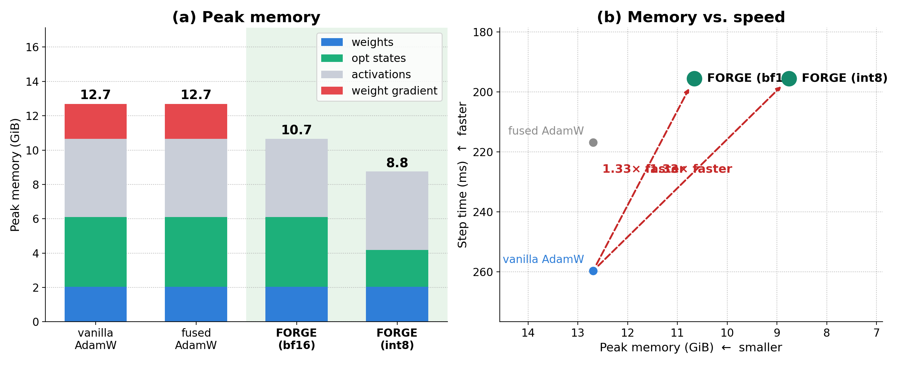
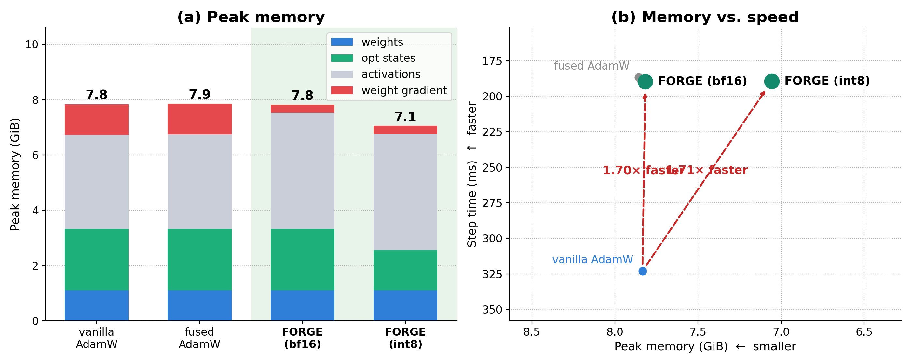
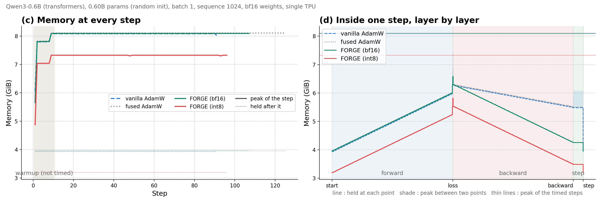

<div align="center">

# 𓉱 FORGE TPU 𓉱

### FORGE (Fused On-Register Gradient Elimination) on Google TPU v5e

</div>
<br>
<br>
<br>


## HEADING-1

- `FusedLinear` (`src/forge_tpu/module.py`) is a drop in replacement for `nn.Linear`. it also holds the optimizer details of that layer (design choice), `FusedLinear.from_linear` wraps an existing `nn.Linear` without copying the weight.
- in backward, `dx = go @ w` is computed first with the old w, then the Pallas kernel (`src/forge_tpu/kernel/fused_grad.py`) runs over a grid of (bv, bh) weight tiles. for each tile it accumulates `go.T @ x` in an fp32 VMEM scratch pad, then reads the w, m, v tile, does the AdamW math and writes them back.
- w and the states are donated to the kernel (`input_output_aliases`), so XLA writes the new values into the same HBM. torch_tpu marks donated tensors as deleted, that is why `_rebind` has to `set_` the weight and the state tensors to the outputs.
- torch tensors reach the jax kernel through `torch.tpu.pallas.jax_op`. its python checks cost about 160us per layer, so `_bridge.py` catches the first launch of every shape and replays it directly after that (about 21us).
- int8 states are int8 + one fp32 scale per 64 rows (`kernel/codecs.py`). to add another optimizer or state format, see the comments at the top of `kernel/optimizers.py` and `kernel/codecs.py`.

## HEADING-2

| Name | .... |
|---|---|
| vanilla AdamW | `torch.optim.AdamW(foreach=False)`, bf16 weights, bf16 states |
| fused AdamW | `torch.optim.AdamW(fused=True)`, bf16 weights, bf16 states |
| FORGE (bf16) | FORGE, bf16 weights, bf16 states |
| FORGE (int8) | FORGE, bf16 weights, int8 states |

## Models

all models use random weights and random data, no weights are downloaded.

- Llama-3.2-1B and Qwen3-0.6B : the model code is from the `transformers` library (`LlamaForCausalLM`, `Qwen3ForCausalLM`) with the numbers of the official `config.json`. every Linear inside the layers is FORGE, the tied embedding / lm_head and the norms stay on torch's fused AdamW.
- MLP : a residual MLP, defined in `benchmarks/mlp.py`. everything in it is FORGE.

| Model | Parameters | Tokens per step |
|---|---|---|
| MLP | 1.09B | 4096 |
| Llama-3.2-1B | 1.24B | 1024 |
| Qwen3-0.6B | 0.60B | 1024 |


## Results (TPU v5e-1)

step time is the median of the timed steps (± std), the first 10 steps are not timed. each run stops after 60 s, that is why the number of steps is different.

for each model there are three plots :

1. memory right before `backward()` and when it ends (weights, states, activations, weight gradient), and memory vs speed.
2. loss at each training step.
3. memory at each step, and memory inside one step, layer by layer.

### MLP

| Method | Peak (GiB) | Step (ms) | TF/s |
|---|:--:|:--:|:--:|
| vanilla AdamW | 12.69 | 259.6 ± 0.0 | 103 |
| fused AdamW | 12.69 | 216.7 ± 0.1 | 124 |
| FORGE (bf16) | 10.66 | 195.5 ± 0.1 | 137 |
| FORGE (int8) | 8.76 | 195.5 ± 0.1 | 137 |




### Llama-3.2-1B

| Method | Peak (GiB) | Step (ms) | TF/s |
|---|:--:|:--:|:--:|
| vanilla AdamW | 11.75 | 237.0 ± 18.2 | 34 |
| fused AdamW | 11.37 | 173.1 ± 16.7 | 46 |
| FORGE (bf16) | 11.31 | 170.6 ± 10.1 | 47 |
| FORGE (int8) | 9.56 | 179.7 ± 8.4 | 45 |


### Qwen3-0.6B

| Method | Peak (GiB) | Step (ms) | TF/s |
|---|:--:|:--:|:--:|
| vanilla AdamW | 8.09 | 520.5 ± 50.5 | 8 |
| fused AdamW | 8.11 | 353.7 ± 56.1 | 12 |
| FORGE (bf16) | 8.10 | 381.4 ± 56.2 | 11 |
| FORGE (int8) | 7.33 | 431.7 ± 33.7 | 10 |





TF/s = model FLOPs of one step (6 x params x tokens, + attention) / step time. the v5e peak is 197 TF/s in bf16.

## IMPORTANT

- MLP : big layers, so the TPU is busy the whole step. here FORGE wins clearly.
- Llama and Qwen : small layers and lots of tiny ops. we can roughly say params per layer higher is where forge performs better than fused, it is better than vanilla any day. if layer width is more but no of layers are less then tpu time dominates over host time and if its the other way around then host time dominates. with qwen the host time is dominating and hence forge looks slower than fused, but mlp tpu time dominates. 
- peak memory : right before backward, we have outputs of previous layer stored into ctx, we have a dx which keeps mutating for next layer in .backward() (this is negligible anyways), we
  have state tensors. and during backward, fused (torch) keeps accumilating new dw (V, H) but also keeps discarding the prev layer outputs (BT, D). let G = total space dw takes and let A = 
  total space all prev layer outputs take. relative to torch, FORGE saves max(0, G - A) (peak memory). for small models (current case) say llama-1B, G=2.3GiB, A=2.2GiB. but for llama-8B, 
  G=15GiB and A=9GiB (both are for 1024 seq_len). hence the saving dont appear significant right now, but for bigger models FORGE must be performing noticably better (both time and space).
- vanilla vs fused AdamW on Llama : their losses drift apart a lot after ~60 steps (the model memorizes 8 fixed sequences and that part is very sensitive to rounding),
  so compare FORGE with fused AdamW there, not with vanilla. (cuz FORGE and fused do kernel math in fp32, but vanilla bf16 does in bf16)

## Correctness

`benchmarks/tests.py` compares FORGE against `torch.optim.AdamW`. (fully AI generated code)
- 153 / 160 checks pass. the 7 that fail are the int8 ones (int8 is not exact, thats expected) and the bias `db` check (bf16 sum, FORGE doesnt touch the bias anyway).
- FORGE (bf16) gives the same result as PyTorch : each weight and state is within 1 bf16 ulp.
- on the MLP, the FORGE (bf16) loss and the fused AdamW loss are almost the same (max difference 0.0005).

## Tiles

the kernel uses one tile size `(bv, bh, bbt)` for every layer (`DEFAULT_TILES` in `src/forge_tpu/kernel/_utils.py`, right now `(512, 1024, 1024)`).
`benchmarks/colab_cell_tiler.py` times many tile sizes on every fused layer shape of the three models and reports the fastest. it changes nothing. (fully AI generated code)
(1024, 1024, 1024) performed best.

## Profile

- `benchmarks/profiling.py` shows where the time of one training step goes, for the same models and methods (fully AI generated code)
- `profile_<model>_timeline.png` : one step on a time axis. for each method, the step as the benchmark runs it (when python has issued each phase, and when the TPU is done), and the same step with a sync after each phase (fully AI generated code) (every code inside benchmarks folder is claude)
- `profile_<model>_table.md` : the same numbers as a table.

## Files

```
src/forge_tpu/
  module.py       FusedLinear (the nn.Linear replacement)
  autograd.py     FusedLinearFunction : forward is F.linear, backward does dx + the fused update
  state.py        FusedOptimizerState : step count, hyperparameters and the state tensors of one layer
  _bridge.py      torch <---> jax/pallas : allocate_state, fused_update, the launch replay, the kick
  kernel/         the pallas kernel (fused_grad.py), optimizers (optimizers.py), state formats (codecs.py)
benchmarks/
  mlp.py llama.py qwen.py     the models + the measure / report code (mlp.py has the shared part)
  tests.py profiling.py tiler.py
  colab_cell_*.py             one Colab cell each
results/                      the latest results zip, unpacked
```

## Known limits

- `torch.compile` doesnt work. (set_ is not tracable, i found no alternative)
- only AdamW as of now. states are bf16 or int8 (thats all v5e supports natively). int8 states need `out_features % 64 == 0`.
- FORGE updates the weight and states of a Linear layer only as of now. update of everything else happens in torch's optimizer.step()
- no gradient accumulation yet (the update happens in every backward).
- do not move or convert the model (`.to()`) after the first training forward : the optimizer state stays with the old weight.
