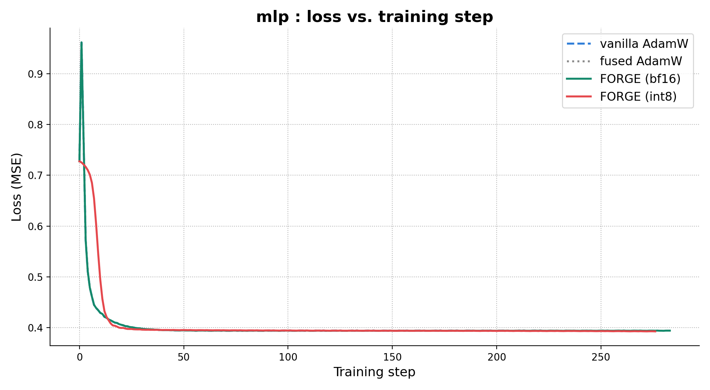
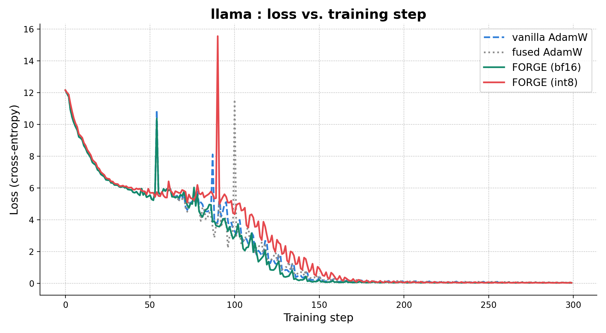
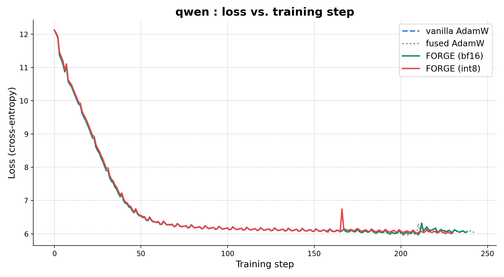

# 𓉱 FORGE TPU 𓉱

### FORGE (Fused On-Register Gradient Elimination) on Google TPU v5e

 
 
 

FORGE updates weights and states in the backward pass.
The full weight gradient is never stored in memory.
This repository runs FORGE on a Google TPU (v5e-1, 16 GB).

## What we compare

| Name | What it is |
|---|---|
| vanilla AdamW | `torch.optim.AdamW(foreach=False)`, bf16 weights, bf16 states |
| fused AdamW | `torch.optim.AdamW(fused=True)`, bf16 weights, bf16 states |
| FORGE (bf16) | FORGE, bf16 weights, bf16 states |
| FORGE (int8) | FORGE, bf16 weights, int8 states |

## Models

All models use random weights and random data. Nothing is downloaded.

| Model | Parameters | Tokens per step |
|---|---|---|
| MLP | 1.09B | 4096 |
| Llama-3.2-1B | 1.24B | 1024 |
| Qwen3-0.6B | 0.60B | 1024 |

## Results (TPU v5e-1)

Step time is the median of the timed steps. The first 10 steps are not timed.

For each model there are three plots:

1. Peak memory and memory vs. speed.
2. Loss at each training step.
3. Memory at each step, and memory inside one step, layer by layer.

### MLP

| Method | Peak (GiB) | Step (ms) | TF/s |
|---|:--:|:--:|:--:|
| vanilla AdamW | 12.69 | 259.6 | 103 |
| fused AdamW | 12.69 | 216.8 | 124 |
| FORGE (bf16) | 10.66 | 195.6 | 137 |
| FORGE (int8) | 8.76 | 195.6 | 137 |

### Llama-3.2-1B

| Method | Peak (GiB) | Step (ms) | TF/s |
|---|:--:|:--:|:--:|
| vanilla AdamW | 11.92 | 195.6 | 41 |
| fused AdamW | 11.20 | 133.2 | 60 |
| FORGE (bf16) | 11.12 | 125.8 | 64 |
| FORGE (int8) | 9.38 | 119.0 | 67 |

### Qwen3-0.6B

| Method | Peak (GiB) | Step (ms) | TF/s |
|---|:--:|:--:|:--:|
| vanilla AdamW | 7.83 | 323.0 | 14 |
| fused AdamW | 7.86 | 186.7 | 23 |
| FORGE (bf16) | 7.82 | 189.7 | 23 |
| FORGE (int8) | 7.06 | 189.4 | 23 |

## Correctness

`benchmarks/tests.py` compares FORGE with `torch.optim.AdamW`.

- FORGE (bf16) gives the same result as PyTorch: each weight and state is within 1 bf16 ulp.
- On the MLP, the FORGE (bf16) loss and the fused AdamW loss are almost the same (max difference 0.0005).

## Known limits

- `torch.compile` doesnt work.