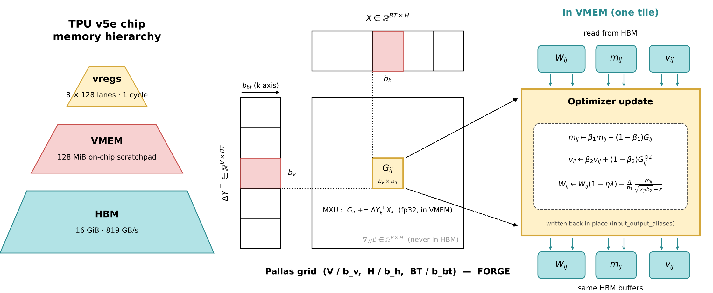
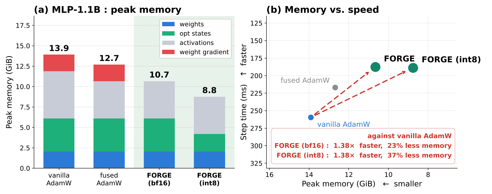
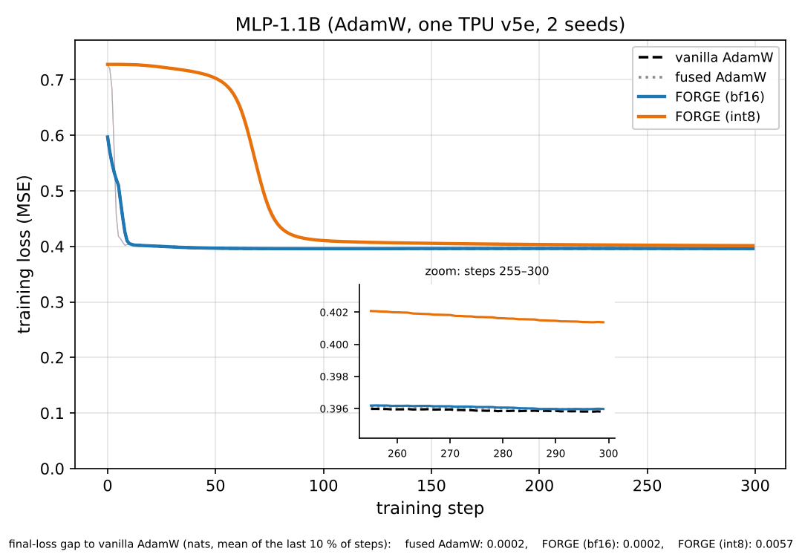
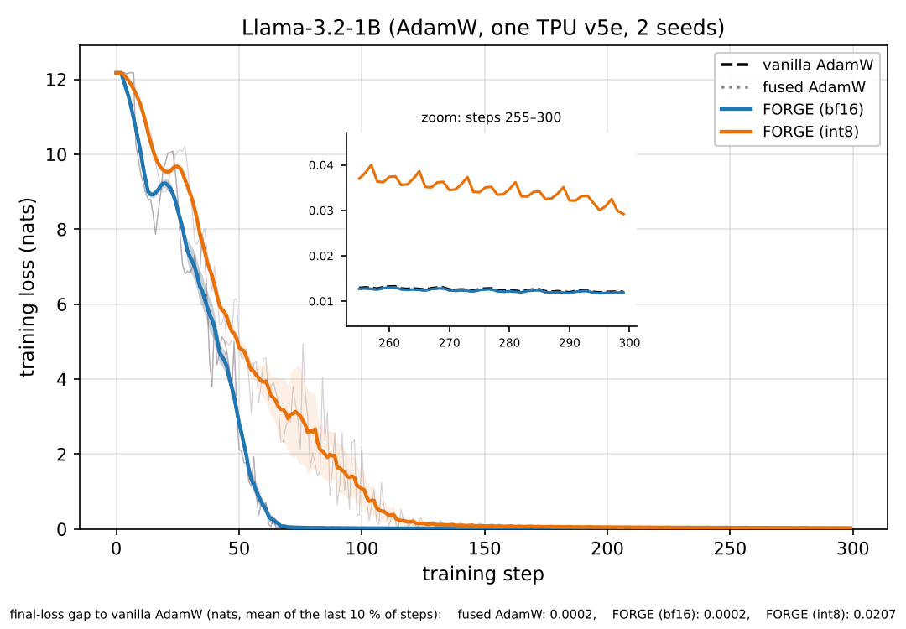
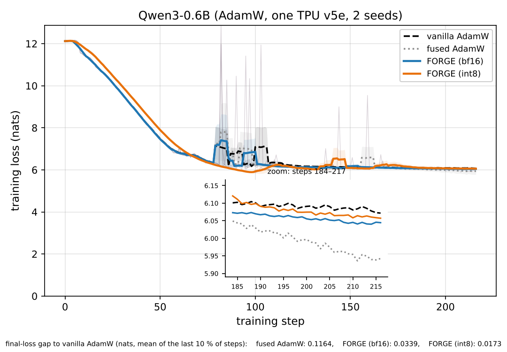
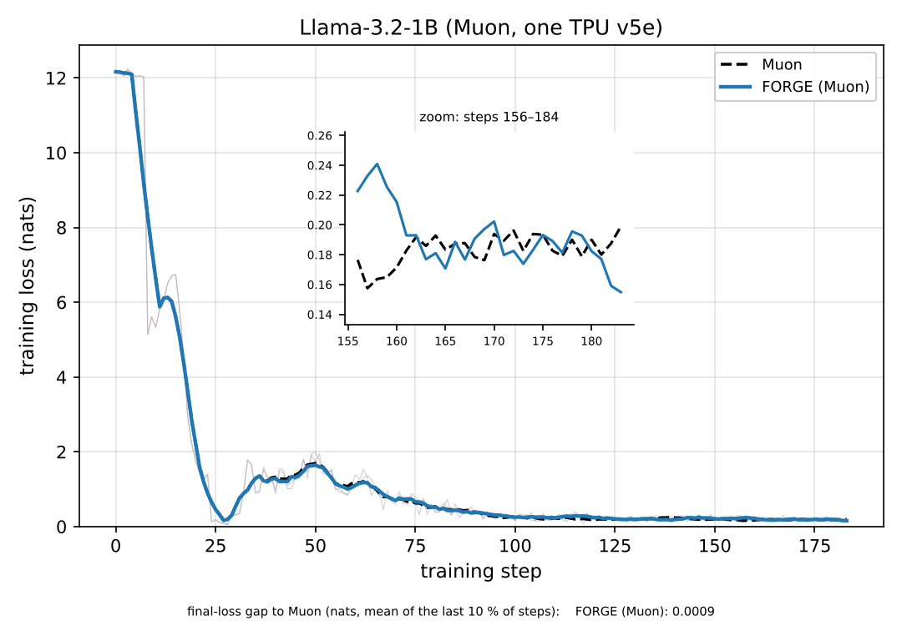
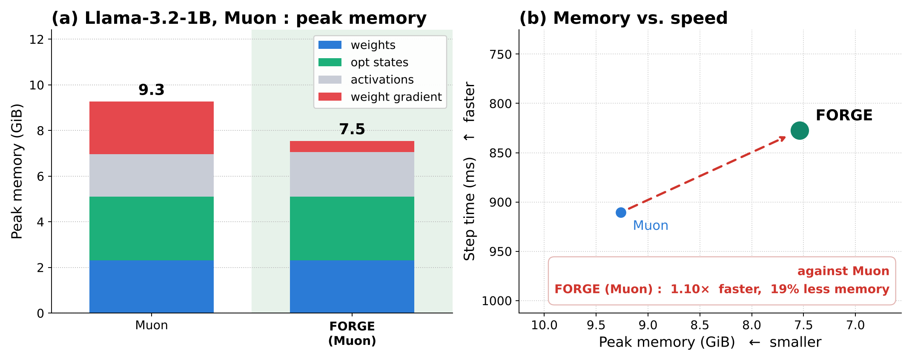

<div align="center">

# 🔥 FORGE · TPU

### Fused On-Register Gradient Elimination on Google TPU v5e

*The weight gradient never reaches HBM — and `optimizer.step()` has nothing left to do.*

[](https://cloud.google.com/tpu/docs/v5e)
[](https://docs.jax.dev/en/latest/pallas/index.html)
[](https://pytorch.org/)

<p align="center"><b><a href="#-highlights">Highlights</a> · <a href="#-key-results-mlp-11b-one-tpu-v5e-chip">Key results</a> · <a href="#-every-model">Every model</a> · <a href="#%EF%B8%8F-where-the-time-goes">Time</a> · <a href="#-convergence-parity">Convergence</a> · <a href="#-muon">Muon</a> · <a href="#-correctness">Correctness</a> · <a href="#-reproduce">Reproduce</a></b></p>

</div>

---

One Pallas kernel fuses the optimizer into the weight-gradient matmul of the backward pass. For every `(b_v, b_h)` weight tile, the MXU accumulates `ΔYᵀX` in an fp32 VMEM tile; AdamW (or Muon's momentum) then reads `W`, `m`, `v` of that tile, updates them, and writes them back **into the same HBM buffers**. **The full `grad_W` is never materialised.**

<div align="center">

</div>

## ✨ Highlights

- **1.38× faster than PyTorch AdamW on one TPU v5e chip** (MLP-1.1B, 259.5 → 187.5 ms/step) and **1.16× faster than fused AdamW**, at **143 TF/s — 73% of the chip's bf16 peak** (vanilla AdamW : 52%).
- **The weight gradient is gone** — 2.03 GiB of `grad_W` on the MLP becomes **0**; peak memory falls **23%** (13.91 → 10.67 GiB), and **37% with int8 moments** (8.76 GiB) at the same speed.
- **`optimizer.step()` disappears** — on Llama-3.2-1B it shrinks from **79.8 ms (vanilla) and 33.0 ms (fused) to 8.4 ms** : **9.5×** and **3.9×** shorter; only the embedding and the norms are left for it.
- **Real transformers too** — Llama-3.2-1B : **1.41× faster** than vanilla AdamW and faster than fused AdamW, with **21% less memory** (35% with int8).
- **Muon too** — momentum fused into the dW tile, Newton–Schulz after backward : Llama-3.2-1B **9.26 → 7.54 GiB (−19%)** and **1.10× faster** than standard Muon.
- **Same training** — FORGE (bf16) ends within **0.0002 nats** of PyTorch AdamW on the MLP and Llama-3.2-1B, and on every model its final loss is never further from vanilla AdamW than fused AdamW's is. **153 / 160** correctness checks pass — every fail is an int8 case (approximate by design) or the bias gradient, which FORGE does not update.

## 📊 Key results (MLP-1.1B, one TPU v5e chip)

<div align="center">

<br><em>The weight gradient (red) is gone under FORGE; its two arms differ only in moment precision. Both are faster than PyTorch's fused AdamW.</em>
</div>

One TPU v5e chip (16 GiB HBM, 197 TF/s bf16), 4096 tokens per step, bf16 weights. Step time : median of 280 timed steps, mean of 2 seeds (± half the gap between them).

| Method | Peak (GiB) | Step (ms) | TF/s | MFU |
|---|:--:|:--:|:--:|:--:|
| vanilla AdamW | 13.91 | 259.5 ± 0.0 | 103 | 52% |
| fused AdamW | 12.69 | 216.7 ± 0.1 | 124 | 63% |
| **FORGE (bf16)** | **10.67** | **187.5 ± 0.0** | **143** | **73%** |
| **FORGE (int8)** | **8.76** | **188.7 ± 0.0** | **142** | **72%** |

**FORGE beats fused AdamW on memory and on step time at once** — and int8 moments take another 2 GiB off at the same speed.

## ⚡ Every model

<div align="center">

<br><em>Against vanilla AdamW on the same chip, mean of 2 seeds.</em>
</div>

| Model | Tokens / step | Method | Peak (GiB) | Step (ms) | vs. vanilla AdamW | vs. fused AdamW |
|---|:--:|---|:--:|:--:|:--:|:--:|
| **MLP-1.1B** | 4096 | vanilla AdamW | 13.91 | 259.5 | | |
| | | fused AdamW | 12.69 | 216.7 | −9% mem · 1.20× | |
| | | **FORGE (bf16)** | **10.67** | **187.5** | **−23% mem · 1.38×** | **−16% mem · 1.16×** |
| | | **FORGE (int8)** | **8.76** | **188.7** | **−37% mem · 1.38×** | **−31% mem · 1.15×** |
| **Llama-3.2-1B** | 512 | vanilla AdamW | 11.79 | 213.7 | | |
| | | fused AdamW | 10.26 | 161.4 | −13% mem · 1.32× | |
| | | **FORGE (bf16)** | **9.35** | **152.1** | **−21% mem · 1.41×** | **−9% mem · 1.06×** |
| | | **FORGE (int8)** | **7.65** | **162.7** | **−35% mem · 1.31×** | **−25% mem** · 0.99× |
| **Qwen3-0.6B** | 512 | vanilla AdamW | 6.03 | 377.6 | | |
| | | fused AdamW | 5.90 | 355.7 | −2% mem · 1.06× | |
| | | **FORGE (bf16)** | **5.87** | **367.4** | **−3% mem · 1.03×** | −0.5% mem · 0.97× |
| | | **FORGE (int8)** | **5.10** | **364.1** | **−15% mem · 1.04×** | **−14% mem** · 0.98× |

<div align="center">
 
<br><em>The larger the layers, the larger the win : on the MLP the TPU is busy the whole step. Qwen3-0.6B has 196 small layers, its step waits for the host issuing tiny ops, and its weight gradient is small next to the 152k-token vocabulary.</em>
</div>

## ⏱️ Where the time goes

One step with a sync after each phase (`benchmarks/profiling.py`, median of 20 steps, ms). The update moves into the backward kernel, so the optimizer step is almost empty.

| Model | Method | Forward | Backward | **Optimizer step** | Step, as trained |
|---|---|:--:|:--:|:--:|:--:|
| Llama-3.2-1B | vanilla AdamW | 52.3 | 83.1 | 79.8 | 188.7 |
| | fused AdamW | 53.6 | 85.3 | 33.0 | 164.5 |
| | **FORGE (bf16)** | 54.7 | 94.3 | **8.4** | **150.3** |
| | **FORGE (int8)** | 53.4 | 99.3 | **8.1** | **158.6** |
| Qwen3-0.6B | vanilla AdamW | 120.4 | 220.1 | 46.1 | 376.8 |
| | fused AdamW | 112.7 | 203.5 | 26.0 | 351.1 |
| | **FORGE (bf16)** | 131.7 | 247.5 | **9.5** | **356.0** |
| | **FORGE (int8)** | 116.4 | 231.4 | **8.7** | **335.3** |

## 📉 Convergence parity

<div align="center">

<br><em>Llama-3.2-1B on one TPU v5e chip, identical data and hyperparameters, mean of 2 seeds : FORGE (bf16) lies on top of PyTorch AdamW for the whole run.</em>
</div>

Final loss (the mean of the last 10% of the steps, and of the 2 seeds) :

| Model | Steps | vanilla AdamW | fused AdamW | FORGE (bf16) | FORGE (int8) |
|---|:--:|:--:|:--:|:--:|:--:|
| MLP-1.1B | 300 | 0.3959 | 0.3960 | **0.3960** | 0.4016 |
| Llama-3.2-1B | 300 | 0.0123 | 0.0121 | **0.0121** | 0.0330 |
| Qwen3-0.6B | 217 | 6.0810 | 5.9387 | **6.0441** | 6.0675 |

<div align="center">
 
<br>
 
<br><em>Raw losses (light), smoothed losses (bold), the range of the 2 seeds (band), a zoom on the last steps. The transformers train on 8 fixed sequences and learn them by heart, a chaotic regime in bf16 — FORGE still follows PyTorch step for step.</em>
</div>

## 🌀 Muon

Only `B = 0.95 B + G` is tile-local, so only it is fused into the dW tile; Newton–Schulz needs the whole matrix and runs after backward. Standard Muon gets `G` from autograd and folds it into `B` in its own pass — the two arms differ only there. 512 tokens per step, 1 seed.

<div align="center">

</div>

| Model | Method | Peak (GiB) | Step (ms) | vs. standard Muon |
|---|---|:--:|:--:|:--:|
| Llama-3.2-1B | Muon | 9.26 | 910.6 ± 31.6 | |
| | **FORGE (Muon)** | **7.54** | **827.5 ± 29.3** | **−19% mem · 1.10×** |
| Qwen3-0.6B | Muon | 5.06 | 1057.6 ± 87.1 | |
| | **FORGE (Muon)** | **5.04** | **1006.9 ± 64.9** | **−0.2% mem · 1.05×** |

## ✅ Correctness

`benchmarks/tests.py` checks FORGE against `torch.optim.AdamW` on the CPU in fp32 : single steps from a non-zero state on four shapes, real-model gradient sizes, 10 steps through two layers, and a small Llama trained with every method — **153 / 160 checks pass** ([report](results/adamw/tests.md)).

- Every bf16 weight and moment of FORGE (bf16) is within **one bf16 ulp** of PyTorch.
- The 7 fails : 6 int8 cases (int8 moments are approximate by design) and the bias gradient `db` (summed in bf16; FORGE does not update the bias).

## 🧠 How it works on TPU

- **One Pallas kernel**, grid `(V/b_v, H/b_h, BT/b_bt)`. The MXU accumulates the gradient tile in fp32; at the last token block the optimizer runs on the tile in vregs. When the token axis is one block, the tile goes straight to the update with no scratch pass.
- **In place.** `W` and the moments are donated (`input_output_aliases`) and the torch tensors are rebound to the new buffers. `dx = ΔY·W` is issued first, with the old `W`, so the chain rule holds.
- **Fast launch.** The first launch of each layer shape goes through `torch.tpu.pallas.jax_op`; every later one is replayed directly.
- **AdamW (bf16 or int8 moments), SGD and Muon** share the kernel (`src/forge_tpu/kernel/optimizers.py`, `codecs.py`). Embeddings, the tied head and the norms stay on fused AdamW.

## 🔁 Reproduce

Paste `benchmarks/colab_cell.py` into one Colab cell (TPU v5e-1) and upload the repo zip. It runs the tests, every training run, the profiles and `benchmarks/report.py`, and downloads `results.zip` (`results/` + `assets/`).

| | |
|---|---|
| Hardware | one TPU v5e chip (Colab) : 16 GiB HBM, 197 TF/s bf16 |
| Software | torch 2.13, torch_tpu 0.3, jax 0.12 (Pallas), transformers 5 |
| Models | MLP-1.1B (8 residual blocks, D 4096, FF 16384); Llama-3.2-1B and Qwen3-0.6B from `transformers` with the official `config.json` numbers; random init, synthetic data |
| Runs | batch 1, 512 tokens (MLP : 4096), 8 fixed batches; 20 lr-warmup steps not timed, then up to 300 steps or 120 s (Muon : 180 s); AdamW seeds 0 and 1, Muon seed 0 |

```
src/forge_tpu/   module.py (FusedLinear) · autograd.py · _bridge.py (torch ↔ Pallas) · muon.py · kernel/ (fused_grad.py, optimizers.py, codecs.py)
benchmarks/      config.py (what runs, where it goes) · methods.py · mlp.py llama.py qwen.py · train.py · profiling.py · tests.py · tiler.py · report.py · colab_cell.py
results/         <optim>/<model>/<method>_seed<N>.json, profile_<method>.json, <optim>/tests.md, summary.md (every table)
assets/          every figure here (benchmarks/report.py)
```
