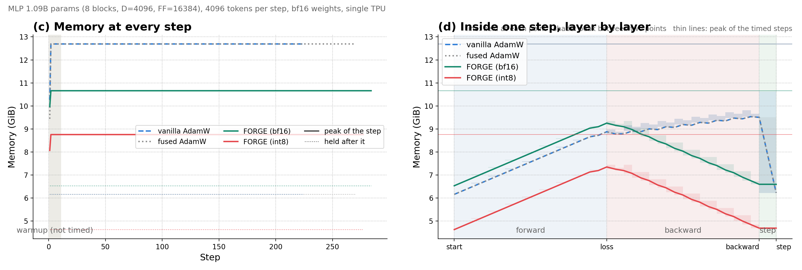
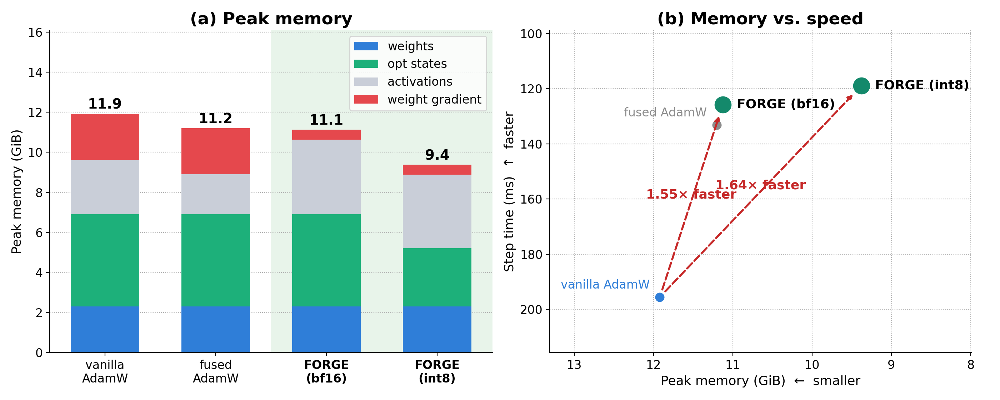
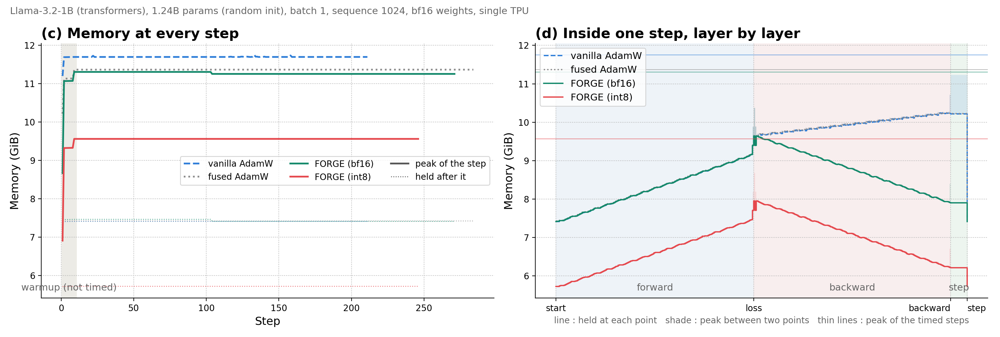

# 𓉱 FORGE TPU 𓉱

### FORGE (Fused On-Register Gradient Elimination) on Google TPU v5e

 
 
 

FORGE updates weights and states in the backward pass.
The full weight gradient is never stored in memory.
This repository runs FORGE on a Google TPU (v5e-1, 16 GB).

## What we compare

| Name | What it is |
|---|---|
| vanilla AdamW | `torch.optim.AdamW(foreach=False)`, bf16 weights, bf16 states |
| fused AdamW | `torch.optim.AdamW(fused=True)`, bf16 weights, bf16 states |
| FORGE (bf16) | FORGE, bf16 weights, bf16 states |
| FORGE (int8) | FORGE, bf16 weights, int8 states |

## Models

All models use random weights and random data. No weights are downloaded.

- Llama-3.2-1B and Qwen3-0.6B: the model code is from the `transformers` library (`LlamaForCausalLM`, `Qwen3ForCausalLM`), with the numbers of the official `config.json`.
- MLP: a residual MLP, defined in `benchmarks/mlp.py`.

| Model | Parameters | Tokens per step |
|---|---|---|
| MLP | 1.09B | 4096 |
| Llama-3.2-1B | 1.24B | 1024 |
| Qwen3-0.6B | 0.60B | 1024 |

## Results (TPU v5e-1)

NOTE: the numbers and plots below are from the runs before two changes (Llama and Qwen3 from `transformers`, int8 floor of `v` back to 1e-8). Run the benchmarks again to update them.

Step time is the median of the timed steps. The first 10 steps are not timed.

For each model there are three plots:

1. Peak memory and memory vs. speed.
2. Loss at each training step.
3. Memory at each step, and memory inside one step, layer by layer.

### MLP

| Method | Peak (GiB) | Step (ms) | TF/s |
|---|:--:|:--:|:--:|
| vanilla AdamW | 12.69 | 259.6 | 103 |
| fused AdamW | 12.69 | 216.8 | 124 |
| FORGE (bf16) | 10.66 | 195.6 | 137 |
| FORGE (int8) | 8.76 | 195.6 | 137 |

### Llama-3.2-1B

| Method | Peak (GiB) | Step (ms) | TF/s |
|---|:--:|:--:|:--:|
| vanilla AdamW | 11.92 | 195.6 | 41 |
| fused AdamW | 11.20 | 133.2 | 60 |
| FORGE (bf16) | 11.12 | 125.8 | 64 |
| FORGE (int8) | 9.38 | 119.0 | 67 |

### Qwen3-0.6B

| Method | Peak (GiB) | Step (ms) | TF/s |
|---|:--:|:--:|:--:|
| vanilla AdamW | 7.83 | 323.0 | 14 |
| fused AdamW | 7.86 | 186.7 | 23 |
| FORGE (bf16) | 7.82 | 189.7 | 23 |
| FORGE (int8) | 7.06 | 189.4 | 23 |

## Correctness

`benchmarks/tests.py` compares FORGE with `torch.optim.AdamW`.

- FORGE (bf16) gives the same result as PyTorch: each weight and state is within 1 bf16 ulp.
- On the MLP, the FORGE (bf16) loss and the fused AdamW loss are almost the same (max difference 0.0005).

## Tiles

The kernel uses one tile size `(bv, bh, bbt)` for every layer (`DEFAULT_TILES` in `src/forge_tpu/kernel/_utils.py`).
`benchmarks/colab_cell_tiler.py` times many tile sizes on every fused layer shape of the three models and reports the fastest. It changes nothing.

## Profile

`benchmarks/profiling.py` shows where the time of one training step goes, for the same models and methods (`colab_cell_all.py` runs it after the benchmarks, `colab_cell_profiling.py` runs it alone).

- `profile_<model>_timeline.png`: one step on a time axis. For each method, the step as the benchmark runs it (when Python has issued each phase, and when the TPU is done), and the same step with a sync after each phase (Python time and TPU time of each phase).
- `profile_<model>_host.png`: the host (Python and PyTorch) time of each phase, in a few groups (FORGE update, optimizer, matmul, attention, ...). Measured with `torch.profiler`, which sees the CPU side only.
- `profile_<model>_table.md`: the same numbers as a table.

## Known limits

- `torch.compile` doesnt work.
- Only AdamW. States are bf16 or int8. int8 states need `out_features % 64 == 0`.
- FORGE updates the weight only. A bias gets a `.grad`: give it to a torch optimizer (FusedLinear gives a warning).
- Do not move or convert the model (`.to()`) after the first training forward: the optimizer state stays with the old weight.

API that FORGE (dk4248) has and this repository does not have:

- No `FusedOptimizerManager`. Do these by hand:
  - LR schedule: set `layer.fusedStateObject.hparams["lr"]` on every FusedLinear before the forward (no recompile).
  - Parameters for the torch optimizer: all parameters that are not a FusedLinear weight (see `benchmarks/llama.py`).
  - Checkpoint: `layer.fusedStateObject.state_dict()` and `load_state_dict()` for each layer. `model.state_dict()` does not hold the optimizer states.
- No gradient accumulation: each `backward()` is one update.
- No per-layer switch back to a normal matmul and a separate optimizer kernel (`use_fused_backward = False`).
- No automatic tile tuning (see Tiles).
