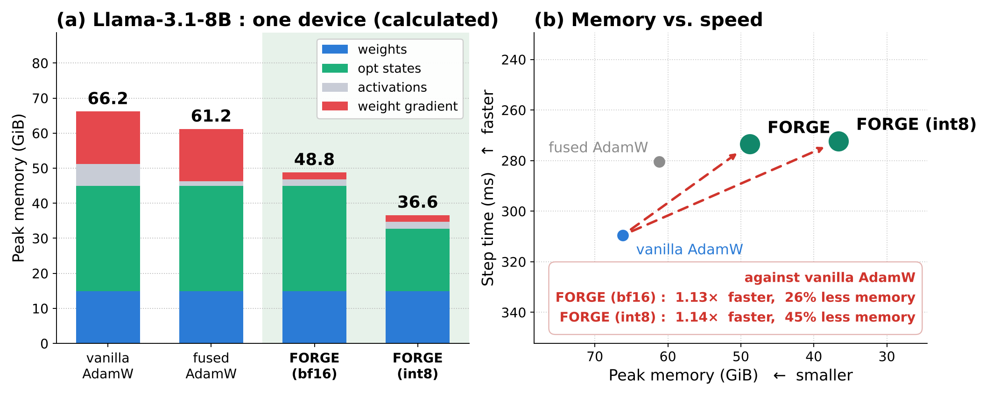
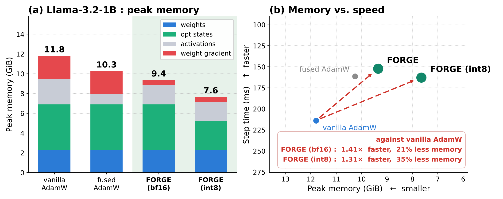
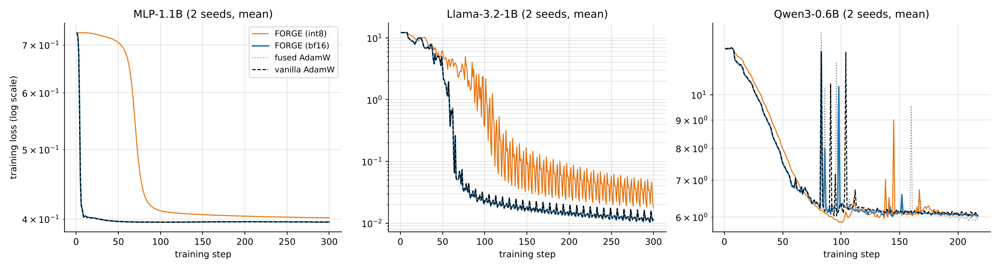

# 🔥 FORGE · TPU

### Fused On-Register Gradient Elimination on Google TPU v5e

*The weight gradient does not go to HBM. The optimizer step has almost no work.*

<b><a href="#-highlights">Highlights</a> · <a href="#%EF%B8%8F-the-main-limit--16-gib-of-hbm">HBM limit</a> · <a href="#-llama-31-8b-tpu-v5e-8">Llama-3.1-8B</a> · <a href="#-key-results-llama-32-1b-one-tpu-v5e-chip">Llama-3.2-1B</a> · <a href="#-every-model">Every model</a> · <a href="#%EF%B8%8F-where-the-time-goes">Time</a> · <a href="#-muon">Muon</a> · <a href="#-how-it-works-on-tpu">How it works</a></b>

---

FORGE puts the optimizer step into the backward pass. One Pallas kernel calculates the weight gradient one tile at a time, in VMEM. The same kernel updates `W`, `m` and `v` of the tile and writes them back into the same HBM buffers. **The full weight gradient is never in HBM.**

## ✨ Highlights

Each number below is against vanilla PyTorch AdamW, then against fused AdamW, on the same TPU.

- **A new FORGE for TPU, written from the start in Pallas, on a new software stack (`torch_tpu` 0.3).**
  - **In place : `W` and the moments go to the kernel as donated HBM buffers. A check on the first launch warns if XLA copies them.**
  - **Fast launch : the first launch of each layer shape is caught inside `torch_tpu` and replayed. The replay skips about 160 µs of checks for each layer; the launch itself takes about 21 µs (measured during development).**
- **Llama-3.1-8B, one device :** the peak memory decreases by **26%** (66.2 → 48.8 GiB) and by **45%** with int8 moments. Against fused AdamW : −20%, −40% with int8 moments. [More details](#-llama-31-8b-tpu-v5e-8).
- **Less memory :** FORGE decreases the peak memory on each model.
  - Llama-3.2-1B : **−21%** (11.79 → 9.35 GiB), **−35%** with int8 moments. Against fused AdamW : −9%, −25%.
  - MLP-1.1B : **−23%** (13.91 → 10.67 GiB), **−37%** with int8 moments. Against fused AdamW : −16%, −31%.
  - Muon, against standard Muon : **−19%** on Llama-3.2-1B, **−17%** on Llama-3.1-8B (one device, calculated).
- **Less time :** FORGE decreases the step time on each model of one chip. FORGE (bf16) is also faster than fused AdamW, except on Qwen3-0.6B ([see why](#-every-model)).
  - Llama-3.2-1B : **−29%** (213.7 → 152.1 ms). Against fused AdamW : −6%.
  - MLP-1.1B : **−28%** (259.5 → 187.5 ms). Against fused AdamW : −13%. The chip runs at **73%** of its bf16 peak (model FLOPs).
  - Optimizer step, Llama-3.2-1B : **−90%** (79.8 → 8.4 ms). Against fused AdamW : −75%.
  - Muon, against standard Muon : **−9%** on Llama-3.2-1B.
- **The main limit is the HBM.** One TPU v5e chip has only 16 GiB of HBM. [See below](#%EF%B8%8F-the-main-limit--16-gib-of-hbm).

## ⚠️ The main limit : 16 GiB of HBM

The largest disadvantage of this work is the small HBM of one TPU v5e chip (16 GiB). In these results, FORGE gives the most improvement on large layers and on large models. Llama-3.1-8B does not fit on one chip.

- **Large layers make FORGE faster.** Against fused AdamW, the step time decreases by 13% on the MLP-1.1B (large layers, 4096 tokens per step) and by 6% on Llama-3.2-1B (smaller layers, 512 tokens per step).
- **Large models make FORGE save more memory.** Against fused AdamW, FORGE saves G − ΔA. G is the weight gradient that FORGE deletes. ΔA is the activations that are in memory at the peak of FORGE but not at the peak of fused AdamW. For the same number of tokens, a larger model has a larger G, but its activations stay small :
  - Llama-3.1-8B (calculated) : 13.0 − 0.6 = 12.4 GiB saved, the peak decreases from 61.2 to 48.8 GiB (−20%).
  - Llama-3.2-1B : 1.8125 − 0.9068 = 0.9057 GiB saved (−9%).
  - Qwen3-0.6B : −0.5% only ([see why](#-every-model)).
- **8 chips :** I could not make the 8 chips of a Kaggle TPU v5e-8 work efficiently in the available time. The Llama-3.1-8B results below are the results of that run.

## 🦙 Llama-3.1-8B (TPU v5e-8)

Llama-3.1-8B ran on the 8 chips of a Kaggle TPU v5e-8, with tensor parallelism. This run was difficult to set up, and a Kaggle TPU v5e-8 has a waiting time of 30 to 40 hours. Thus there is only one configuration : batch 1, sequence 512, one seed, 200 steps (the first 10 not timed, no lr warmup). The code is `benchmarks/kaggle/`. These numbers come from a slightly earlier version of `src/`. A new run with the current `src/` can give different numbers.

- **The memory is calculated, not measured.** The peak memory of each chip was measured. A script converts it to the memory of one device. Each chip holds 1/8 of the weights, the optimizer states and the weight gradient : the script multiplies them by 8. Most activations on each chip are copies that all 8 chips hold (for example the residual stream). The script counts these copies one time : it multiplies the activations by 2.64, not by 8.
- **The step time is slow.** I could not make the 8 chips work together efficiently. They give 92 TF/s together, 6% of their peak. Use these times only to compare the methods. On this setup, the two FORGE methods are the fastest.

| Method | Peak of one device, calculated (GiB) | Step on 8 chips (ms) | vs. vanilla AdamW | vs. fused AdamW |
|---|:--:|:--:|:--:|:--:|
| vanilla AdamW | 66.2 | 309.5 |  |  |
| fused AdamW | 61.2 | 280.4 | -8% memory · -9% time |  |
| **FORGE (bf16)** | **48.8** | **273.5** | **-26% memory · -12% time** | **-20% memory · -2% time** |
| **FORGE (int8)** | **36.6** | **272.2** | **-45% memory · -12% time** | **-40% memory · -3% time** |

## 📊 Key results (Llama-3.2-1B, one TPU v5e chip)

`transformers` Llama-3.2-1B (1.24B parameters), one TPU v5e chip (16 GiB HBM, 197 TF/s bf16), batch 1, sequence 512, bf16 weights. Step time : the median of 280 timed steps. Each value is the mean of 2 seeds (± half the difference between the seeds).

| Method | Peak (GiB) | weight gradient (GiB) | Step (ms) | vs. vanilla AdamW | vs. fused AdamW |
|---|:--:|:--:|:--:|:--:|:--:|
| vanilla AdamW | 11.79 | 2.30 | 213.7 ± 3.0 |  |  |
| fused AdamW | 10.26 | 2.30 | 161.4 ± 7.3 | -13% memory · -24% time |  |
| **FORGE (bf16)** | **9.35** | **0.49** | **152.1 ± 2.9** | **-21% memory · -29% time** | **-9% memory · -6% time** |
| **FORGE (int8)** | **7.65** | **0.49** | **162.7 ± 0.4** | **-35% memory · -24% time** | **-25% memory · +1% time** |

**FORGE (bf16) uses less memory and less time than fused AdamW.**
- Fused AdamW has its peak at the end of the backward pass, when all weight gradients are in memory.
- FORGE keeps no weight gradients, thus its peak moves to the start of the backward pass. At the end of the backward pass, FORGE holds 2.07 GiB less than fused AdamW.
- The weight gradient that stays (0.49 GiB) belongs to the tied embedding and the norms. PyTorch updates them, not FORGE.
- The decrease is smaller than on Llama-3.1-8B because the model is small. The activations are 0.46× the size of the weights here, and 0.09× on Llama-3.1-8B (calculated). Thus on Llama-3.1-8B the peak decreases by almost all of the deleted gradient (95%).

## ⚡ Every model

| Model | Method | Peak (GiB) | Step (ms) | vs. vanilla AdamW | vs. fused AdamW |
|---|---|:--:|:--:|:--:|:--:|
| **MLP-1.1B** | vanilla AdamW | 13.91 | 259.5 |  |  |
|  | fused AdamW | 12.69 | 216.7 | -9% memory · -16% time |  |
|  | **FORGE (bf16)** | **10.67** | **187.5** | **-23% memory · -28% time** | -16.0% memory · -13.5% time |
|  | **FORGE (int8)** | **8.76** | **188.7** | **-37% memory · -27% time** | -31.0% memory · -12.9% time |
| **Llama-3.2-1B** | vanilla AdamW | 11.79 | 213.7 |  |  |
|  | fused AdamW | 10.26 | 161.4 | -13% memory · -24% time |  |
|  | **FORGE (bf16)** | **9.35** | **152.1** | **-21% memory · -29% time** | -8.8% memory · -5.8% time |
|  | **FORGE (int8)** | **7.65** | **162.7** | **-35% memory · -24% time** | -25.5% memory · +0.8% time |
| **Qwen3-0.6B** | vanilla AdamW | 6.03 | 377.6 |  |  |
|  | fused AdamW | 5.90 | 355.7 | -2% memory · -6% time |  |
|  | **FORGE (bf16)** | **5.87** | **367.4** | **-3% memory · -3% time** | -0.5% memory · +3.3% time |
|  | **FORGE (int8)** | **5.10** | **364.1** | **-15% memory · -4% time** | -13.5% memory · +2.4% time |

 

**Qwen3-0.6B gets only a small improvement :**
- **Memory.** For each method, the peak is at the start of the backward pass. There, the activations and the logits over the 151,936-token vocabulary are in memory, and no weight gradient exists yet. FORGE holds 1.05 GiB less at the end of the backward pass, but that is not the peak. Against fused AdamW, the peak decreases by 0.5% only. With int8 moments it decreases by 13.5%, because the moments are in memory at the peak.
- **Time.** Qwen3-0.6B has 196 small weight matrices. With FORGE, the backward pass takes 44.0 ms more than with fused AdamW, and the updates use 24.2 ms of Python time. The optimizer step takes only 16.5 ms less. Thus the step time increases by 3.3%.
- **A larger Qwen3 model** has larger weight matrices and a larger weight gradient, but the same loss memory. Thus we expect better results on it. It was not run.

## ⏱️ Where the time goes

`benchmarks/profiling.py`, seed 0, median of 20 steps, ms. Forward, backward, optimizer step : a sync after each phase. Step, as trained : one sync at the end, as in the benchmark.

| Model | Method | Forward | Backward | **Optimizer step** | Step, as trained |
|---|---|:--:|:--:|:--:|:--:|
| Llama-3.2-1B | vanilla AdamW | 52.3 | 83.1 | 79.8 | 188.7 |
|  | fused AdamW | 53.6 | 85.3 | 33.0 | 164.5 |
|  | **FORGE (bf16)** | 54.7 | 94.3 | **8.4** | **150.3** |
|  | **FORGE (int8)** | 53.4 | 99.3 | **8.1** | **158.6** |
| Qwen3-0.6B | vanilla AdamW | 120.4 | 220.1 | 46.1 | 376.8 |
|  | fused AdamW | 112.7 | 203.5 | 26.0 | 351.1 |
|  | **FORGE (bf16)** | 131.7 | 247.5 | **9.5** | **356.0** |
|  | **FORGE (int8)** | 116.4 | 231.4 | **8.7** | **335.3** |

## 📉 Convergence

Each curve is the loss of each step : the mean of 2 seeds, without smoothing. Each model trains on 8 fixed batches.

- **FORGE (bf16) follows PyTorch.** The mean distance between its loss and the loss of fused AdamW, step by step : 0.0001 (MLP-1.1B), 0.0017 (Llama-3.2-1B), 0.109 (Qwen3-0.6B). For vanilla AdamW it is 0.0001, 0.0027 and 0.163.
- **int8 moments converge more slowly.** The loss reaches the middle of its decrease (on the log scale of the figure) at step 71 instead of 5 on the MLP-1.1B, and at step 100 instead of 59 on Llama-3.2-1B. The final loss is also higher.
- **Qwen3-0.6B does not converge in these steps.** Each method has loss spikes, and each method stops near 6.0.

The final loss is the mean over the last 10% of the steps that all methods ran, and over the 2 seeds :

| Model | Steps | vanilla AdamW | fused AdamW | FORGE (bf16) | FORGE (int8) |
|---|:--:|:--:|:--:|:--:|:--:|
| MLP-1.1B | 300 | 0.3959 | 0.3960 | **0.3960** | **0.4016** |
| Llama-3.2-1B | 300 | 0.0123 | 0.0121 | **0.0121** | **0.0330** |
| Qwen3-0.6B | 217 | 6.0848 | 5.9684 | **6.0509** | **6.0675** |

## 🌀 Muon

Muon calculates `B = 0.95 B + G` for each weight. This step is local to each tile, thus FORGE does it in the dW tile. Newton–Schulz needs the full matrix, thus it runs after the backward pass. Standard Muon gets `G` from autograd and calculates `B` in a separate pass. One seed.

| Model | Method | Peak (GiB) | Step (ms) | vs. standard Muon |
|---|---|:--:|:--:|:--:|
| Llama-3.2-1B | Muon | 9.26 | 910.6 |  |
|  | **FORGE (Muon)** | **7.54** | **827.5** | **-18.6% memory · -9.1% time** |
| Qwen3-0.6B | Muon | 5.06 | 1057.6 |  |
|  | **FORGE (Muon)** | **5.04** | **1006.9** | **-0.2% memory · -4.8% time** |
| Llama-3.1-8B, one device (calculated), 8 chips | Muon | 56.38 | 2439.7 |  |
|  | **FORGE (Muon)** | **46.89** | **2342.0** | **-16.8% memory · -4.0% time** |

On Qwen3-0.6B the peak decreases by only 0.2%, for the same cause as with AdamW.

## 🧠 How it works on TPU

- **One Pallas kernel**, grid `(V/b_v, H/b_h, BT/b_bt)`. The MXU adds the gradient of each tile in fp32. Then the optimizer updates the tile.
- **In place.** `W` and the moments go to the kernel as donated buffers (`input_output_aliases`). The kernel writes the new values into the same HBM. It calculates `dx = ΔY·W` first, with the old `W`.
- **Optimizers.** AdamW (bf16 or int8 moments), SGD and Muon use the same kernel (`src/forge_tpu/kernel/`). PyTorch's fused AdamW updates the embeddings, the tied head and the norms.
- **Reproduce.** Paste `benchmarks/colab_cell.py` into one Colab cell (TPU v5e-1) and upload the repository zip. `benchmarks/report.py` writes all tables (`results/summary.md`), figures (`assets/`) and numbers of this README from `results/`. For Llama-3.1-8B : `benchmarks/kaggle/kaggle_cell.py` on a Kaggle TPU v5e-8 (see `benchmarks/kaggle/README.md`).
