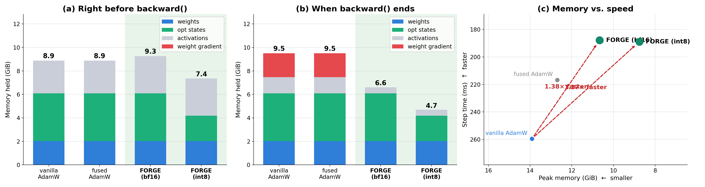
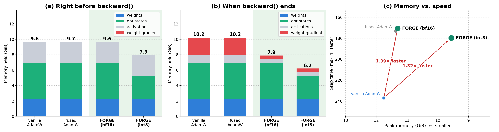
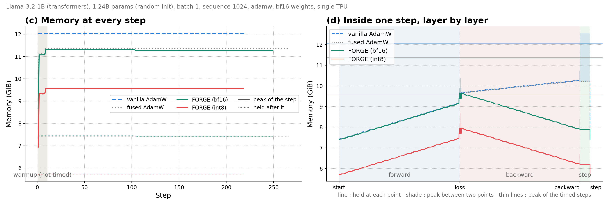
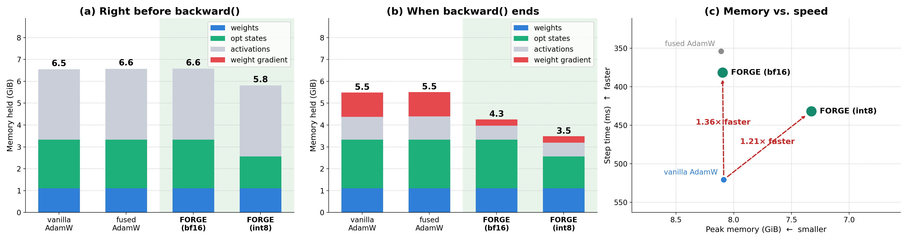
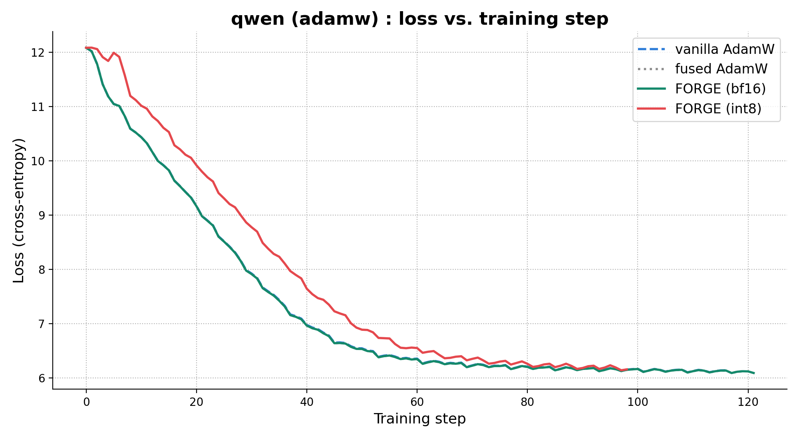

<div align="center">

# 𓉱 FORGE TPU 𓉱

### FORGE (Fused On-Register Gradient Elimination) on Google TPU v5e

</div>
<br>
<br>
<br>


## HEADING-1

- `FusedLinear` (`src/forge_tpu/module.py`) is a drop in replacement for `nn.Linear`. it also holds the optimizer details of that layer (design choice), `FusedLinear.from_linear` wraps an existing `nn.Linear` without copying the weight.
- in backward, `dx = go @ w` is computed first with the old w, then the Pallas kernel (`src/forge_tpu/kernel/fused_grad.py`) runs over a grid of (bv, bh) weight tiles. for each tile it accumulates `go.T @ x` in an fp32 VMEM scratch pad, then reads the w, m, v tile, does the AdamW math and writes them back.
- w and the states are donated to the kernel (`input_output_aliases`), so XLA writes the new values into the same HBM. torch_tpu marks donated tensors as deleted, that is why `_rebind` has to `set_` the weight and the state tensors to the outputs.
- torch tensors reach the jax kernel through `torch.tpu.pallas.jax_op`. its python checks cost about 160us per layer, so `_bridge.py` catches the first launch of every shape and replays it directly after that (about 21us).
- int8 states are int8 + one fp32 scale per 64 rows (`kernel/codecs.py`). to add another optimizer or state format, see the comments at the top of `kernel/optimizers.py` and `kernel/codecs.py`.

## HEADING-2

| Name | .... |
|---|---|
| vanilla AdamW | `torch.optim.AdamW()` (torch's defaults), bf16 weights, bf16 states |
| fused AdamW | `torch.optim.AdamW(fused=True)`, bf16 weights, bf16 states |
| FORGE (bf16) | FORGE, bf16 weights, bf16 states |
| FORGE (int8) | FORGE, bf16 weights, int8 states |

## Models

all models use random weights and random data, no weights are downloaded.

- Llama-3.2-1B and Qwen3-0.6B : the model code is from the `transformers` library (`LlamaForCausalLM`, `Qwen3ForCausalLM`) with the numbers of the official `config.json`. every Linear inside the layers is FORGE, the tied embedding / lm_head and the norms stay on torch's fused AdamW.
- MLP : a residual MLP, defined in `benchmarks/mlp.py`. everything in it is FORGE.

| Model | Parameters | Tokens per step |
|---|---|---|
| MLP | 1.09B | 4096 |
| Llama-3.2-1B | 1.24B | 1024 |
| Qwen3-0.6B | 0.60B | 1024 |


## Results (TPU v5e-1)

every number and plot below comes from `results/adamw/` : `benchmarks/readme.py` writes them into this file (the blocks between `<!-- auto -->` comments), so do not edit them by hand.
step time is the median of the timed steps (± std), the first 10 steps are not timed. each run stops at 300 steps or after 60 s, that is why the number of steps is different
(Qwen : 1000 steps, from a separate benchmark-only run, because 60 s was too noisy). the caption above each table gives the number of timed steps.

for each model there are three plots :

1. memory right before `backward()` and when it ends (weights, states, activations, weight gradient), and memory vs speed.
2. loss at each training step.
3. memory at each step, and memory inside one step, layer by layer.

### MLP

<!-- auto:results adamw/mlp -->
MLP, 1.09B params, adamw. Step time : median (± std) of 213 to 260 timed steps of each run, after 10 warmup steps. Peak : the largest step peak above the data.

| Method | Peak (GiB) | Step (ms) | TF/s |
|---|:--:|:--:|:--:|
| vanilla AdamW | 13.91 | 259.6 ± 0.2 | 103 ± 0 |
| fused AdamW | 12.69 | 216.8 ± 0.2 | 124 ± 0 |
| FORGE (bf16) | 10.67 | 187.8 ± 0.1 | 143 ± 0 |
| FORGE (int8) | 8.76 | 189.0 ± 0.2 | 142 ± 0 |

| Method | Loss at step 223 (last common step) | max \|loss − vanilla AdamW\| (steps 1 to 223) |
|---|:--:|:--:|
| vanilla AdamW | 0.3941 | 0.0000 |
| fused AdamW | 0.3941 | 0.0004 |
| FORGE (bf16) | 0.3941 | 0.0004 |
| FORGE (int8) | 0.4028 | 0.3211 |




<!-- /auto -->

### Llama-3.2-1B

<!-- auto:results adamw/llama -->
Llama-3.2-1B, 1.24B params, adamw. Step time : median (± std) of 208 to 256 timed steps of each run, after 10 warmup steps. Peak : the largest step peak above the data.

| Method | Peak (GiB) | Step (ms) | TF/s |
|---|:--:|:--:|:--:|
| vanilla AdamW | 12.04 | 226.1 ± 10.9 | 35 ± 2 |
| fused AdamW | 11.37 | 183.7 ± 20.1 | 44 ± 5 |
| FORGE (bf16) | 11.31 | 159.7 ± 15.7 | 50 ± 5 |
| FORGE (int8) | 9.57 | 159.1 ± 19.5 | 50 ± 6 |

| Method | Loss at step 218 (last common step) | max \|loss − vanilla AdamW\| (steps 1 to 218) |
|---|:--:|:--:|
| vanilla AdamW | 0.0426 | 0.0000 |
| fused AdamW | 0.0387 | 8.9854 |
| FORGE (bf16) | 0.0381 | 10.5057 |
| FORGE (int8) | 0.2533 | 7.5098 |




<!-- /auto -->

### Qwen3-0.6B

<!-- auto:results adamw/qwen -->
Qwen3-0.6B, 0.60B params, adamw. Step time : median (± std) of 990 timed steps of each run, after 10 warmup steps. Peak : the largest step peak above the data.

| Method | Peak (GiB) | Step (ms) | TF/s |
|---|:--:|:--:|:--:|
| vanilla AdamW | 8.14 | 394.0 ± 43.7 | 11 ± 1 |
| fused AdamW | 8.11 | 362.3 ± 39.3 | 12 ± 1 |
| FORGE (bf16) | 8.10 | 367.7 ± 36.3 | 12 ± 1 |
| FORGE (int8) | 7.33 | 371.0 ± 38.8 | 12 ± 1 |

| Method | Loss at step 1000 (last common step) | max \|loss − vanilla AdamW\| (steps 1 to 1000) |
|---|:--:|:--:|
| vanilla AdamW | 2.5772 | 0.0000 |
| fused AdamW | 6.0923 | 4.4498 |
| FORGE (bf16) | 0.2282 | 4.0127 |
| FORGE (int8) | 5.9495 | 12.6477 |




<!-- /auto -->

TF/s = model FLOPs of one step (6 x params x tokens, + attention) / step time. the v5e peak is 197 TF/s in bf16.

## IMPORTANT

- MLP : big layers, so the TPU is busy the whole step. here FORGE wins clearly.
- Llama and Qwen : small layers and lots of tiny ops. we can roughly say params per layer higher is where forge performs better than fused, it is better than vanilla any day. if layer width is more but no of layers are less then tpu time dominates over host time and if its the other way around then host time dominates. we want tpu time to dominate since tpu and host run parallel at times and FORGE improves tpu time only.
- peak memory : right before backward, we have outputs of previous layer stored into ctx, we have a dx which keeps mutating for next layer in .backward() (this is negligible anyways), we
  have state tensors. and during backward, fused (torch) keeps accumilating new dw (V, H) but also keeps discarding the prev layer outputs (BT, D). let G = total space dw takes and let A = 
  total space all prev layer outputs take. relative to torch, FORGE saves max(0, G - A) (peak memory). for small models (current case) say llama-1B, G=2.3GiB, A=2.2GiB. but for llama-8B, 
  G=15GiB and A=9GiB (both are for 1024 seq_len). hence the saving dont appear significant right now, but for bigger models FORGE must be performing noticably better (both time and space).
- vanilla vs fused AdamW on Llama : their losses drift apart a lot after ~60 steps (the model memorizes 8 fixed sequences and that part is very sensitive to rounding),
  so compare FORGE with fused AdamW there, not with vanilla. (cuz FORGE and fused do kernel math in fp32, but vanilla bf16 does in bf16)

## Correctness

`benchmarks/tests.py` compares FORGE against `torch.optim.AdamW`. (fully AI generated code)
- 153 / 160 checks pass. the 7 that fail are the int8 ones (int8 is not exact, thats expected) and the bias `db` check (bf16 sum, FORGE doesnt touch the bias anyway).
- FORGE (bf16) gives the same result as PyTorch : each weight and state is within 1 bf16 ulp.
- on the MLP, the FORGE (bf16) loss and the fused AdamW loss are almost the same (max difference <!-- auto:lossdiff adamw/mlp forge_bf16 adamw_fused -->0.0002<!-- /auto -->).

## Tiles

the kernel uses one tile size `(bv, bh, bbt)` for every layer (`DEFAULT_TILES` in `src/forge_tpu/kernel/_utils.py`, right now `(512, 2048, 2048)`).
`benchmarks/colab_cell_tiler.py` times many tile sizes on every fused layer shape of the three models and reports the fastest. it changes nothing. (fully AI generated code)
(512, 2048, 2048) performed best as one triple for all three models, for AdamW and SGD (against the old default (512, 1024, 1024) : MLP 0.88 / 0.95, Llama 0.89 / 0.88, Qwen 1.04 / 1.05 of the time). the results above ran with it.

## Profile

`benchmarks/profiling.py` shows where the time of one training step goes. its tables and plots are only in [results/adamw/README.md](results/adamw/README.md) and [results/sgd/README.md](results/sgd/README.md).

## Files

```
src/forge_tpu/
  module.py       FusedLinear (the nn.Linear replacement)
  autograd.py     FusedLinearFunction : forward is F.linear, backward does dx + the fused update
  state.py        FusedOptimizerState : step count, hyperparameters and the state tensors of one layer
  _bridge.py      torch <---> jax/pallas : allocate_state, fused_update, the launch replay
  kernel/         the pallas kernel (fused_grad.py), optimizers (optimizers.py), state formats (codecs.py)
benchmarks/
  mlp.py llama.py qwen.py     the models + the measure / report code (mlp.py has the shared part)
  tests.py profiling.py tiler.py
  methods.py                  the optimizers of the benchmarks and their methods (OPTIM : adamw or sgd)
  readme.py                   writes the numbers and plots of results/ into the READMEs (no torch : run it after new results are unpacked)
  colab_cell_*.py             one Colab cell each (OPTIMS at the top : the optimizers to run)
results/adamw/                the latest AdamW results zip, unpacked (README.md : its tables and plots, written by readme.py)
results/sgd/                  the latest SGD results
```

## Known limits

- `torch.compile` doesnt work. (set_ is not tracable, i found no alternative)
- only AdamW and SGD (no momentum) as of now. AdamW states are bf16 or int8 (thats all v5e supports natively). int8 states need `out_features % 64 == 0`.
- FORGE updates the weight and states of a Linear layer only as of now. update of everything else happens in torch's optimizer.step()
- no gradient accumulation yet (the update happens in every backward).
