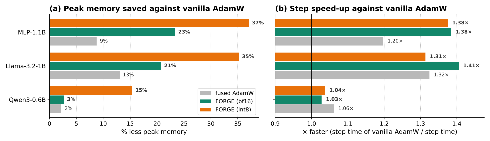
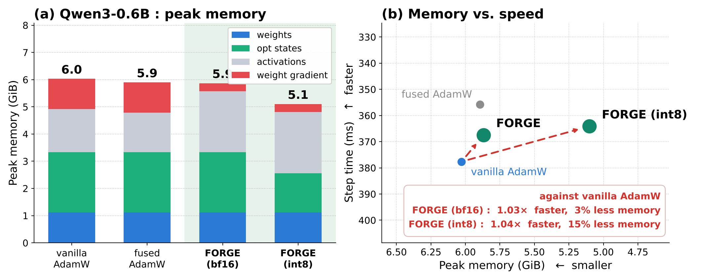
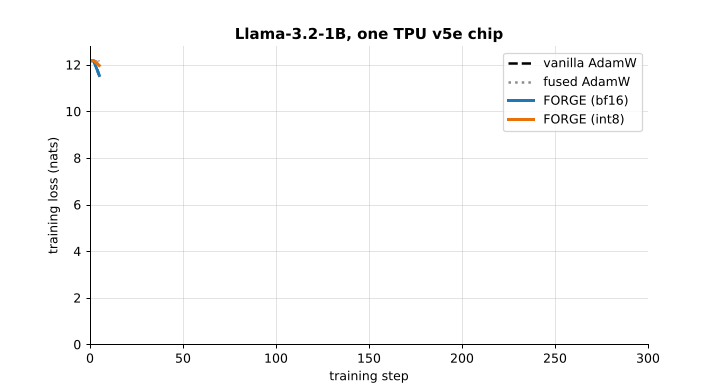

# 🔥 FORGE · TPU

### Fused On-Register Gradient Elimination on Google TPU v5e

*The weight gradient never reaches HBM — and `optimizer.step()` has nothing left to do.*

<b><a href="#-highlights">Highlights</a> · <a href="#-key-results-llama-32-1b-one-tpu-v5e-chip">Llama-3.2-1B</a> · <a href="#-llama-31-8b-tpu-v5e-8">Llama-3.1-8B</a> · <a href="#-every-model">Every model</a> · <a href="#%EF%B8%8F-where-the-time-goes">Time</a> · <a href="#-muon">Muon</a> · <a href="#-how-it-works-on-tpu">How it works</a></b>

---

One Pallas kernel fuses the optimizer into the weight-gradient matmul of the backward pass. For every weight tile the MXU accumulates the gradient in VMEM, the optimizer updates `W`, `m`, `v` of that tile, and writes them back **into the same HBM buffers**. **The full `grad_W` is never materialised.**

## ✨ Highlights

- **1.41× faster than PyTorch AdamW on Llama-3.2-1B** (one TPU v5e chip, 213.7 → 152.1 ms/step), also faster than fused AdamW (161.4 ms), with **21% less peak memory** (11.79 → 9.35 GiB) — **35% less with int8 moments**.
- **Llama-3.1-8B : 17.4 GiB less memory** — on one device FORGE needs **48.8 GiB instead of 66.2 (vanilla AdamW) and 61.2 (fused AdamW)**, and **36.6 GiB with int8 moments (−45%, 29.5 GiB saved)**. Calculated from a run on 8 chips, [see below](#-llama-31-8b-tpu-v5e-8).
- **`optimizer.step()` disappears** — on Llama-3.2-1B it shrinks from **79.8 ms (vanilla) and 33.0 ms (fused) to 8.4 ms**; only the embedding and the norms are left for it.
- **Up to 73% of the chip's peak** — with large layers (MLP-1.1B) FORGE is **1.38× faster than vanilla AdamW and 1.16× faster than fused AdamW**, at 143 TF/s.
- **Muon too** — **19% less memory and 1.10× faster** than standard Muon on Llama-3.2-1B; **9.5 GiB less (−17%)** on Llama-3.1-8B.
- **Same training, checked** — on Llama-3.2-1B and the MLP the FORGE (bf16) loss ends within **0.0002 nats** of PyTorch AdamW, and on every model it is never further from it than fused AdamW's; **153 / 160** correctness checks pass (every fail is an int8 case, approximate by design, or the bias gradient, which FORGE does not update).

## 📊 Key results (Llama-3.2-1B, one TPU v5e chip)

`transformers` Llama-3.2-1B (1.24B params), one TPU v5e chip (16 GiB, 197 TF/s bf16), batch 1, sequence 512, bf16 weights. Step time : median of 280 timed steps, mean of 2 seeds (± half the gap between them).

| Method | Peak (GiB) | weight gradient (GiB) | Step (ms) | TF/s |
|---|:--:|:--:|:--:|:--:|
| vanilla AdamW | 11.79 | 2.30 | 213.7 ± 3.0 | 18 |
| fused AdamW | 10.26 | 2.30 | 161.4 ± 7.3 | 24 |
| **FORGE (bf16)** | **9.35** | **0.49** | **152.1 ± 2.9** | **26** |
| **FORGE (int8)** | **7.65** | **0.49** | **162.7 ± 0.4** | **24** |

**FORGE (bf16) beats fused AdamW on memory and on step time at once.** Fused AdamW reaches its peak at the end of backward, when every weight gradient is alive; FORGE has no gradient pool, so its peak moves to the start of backward and it ends backward holding 2.07 GiB less. What is left of the weight gradient belongs to the tied embedding, which stays on torch.
**int8 moments** take another 1.71 GiB off, but the moments are unpacked and packed again in every tile : the backward takes 5.0 ms longer than with bf16 moments, so int8 runs at 0.99× the speed of fused AdamW.

## 🦙 Llama-3.1-8B (TPU v5e-8)

Llama-3.1-8B does not fit on one 16 GiB chip, so it ran tensor parallel on the 8 chips of a TPU v5e-8 (batch 1, sequence 512, one seed).

- **Memory is calculated, not measured.** The peak of each chip was measured, then converted to one device : weights, optimizer states and weight gradient × 8 (each chip holds exactly 1/8 of them), and the activations that every chip holds a copy of are counted once (× 2.64 instead of × 8 : the ratio of one-device to one-chip activations, from a one-device run of the same model and data on another accelerator).
- **Step time is slow** : I could not make the 8 chips work together efficiently — they reach 92 TF/s together, 6% of their peak. The times compare the methods with each other on the same setup, where both FORGE arms are the fastest.

| Method | Peak of one device, calculated (GiB) | vs. vanilla AdamW | Step on 8 chips (ms) |
|---|:--:|:--:|:--:|
| vanilla AdamW | 66.2 |  | 309.5 |
| fused AdamW | 61.2 | −8% | 280.4 |
| **FORGE (bf16)** | **48.8** | **−26%** | **273.5** |
| **FORGE (int8)** | **36.6** | **−45%** | **272.2** |

## ⚡ Every model

| Model | Method | Peak (GiB) | Step (ms) | vs. vanilla AdamW | vs. fused AdamW |
|---|---|:--:|:--:|:--:|:--:|
| **MLP-1.1B** | vanilla AdamW | 13.91 | 259.5 |  |  |
|  | fused AdamW | 12.69 | 216.7 | −9% mem · 1.20× |  |
|  | **FORGE (bf16)** | **10.67** | **187.5** | **−23% mem · 1.38×** | −16.0% mem · 1.16× |
|  | **FORGE (int8)** | **8.76** | **188.7** | **−37% mem · 1.38×** | −31.0% mem · 1.15× |
| **Llama-3.2-1B** | vanilla AdamW | 11.79 | 213.7 |  |  |
|  | fused AdamW | 10.26 | 161.4 | −13% mem · 1.32× |  |
|  | **FORGE (bf16)** | **9.35** | **152.1** | **−21% mem · 1.41×** | −8.8% mem · 1.06× |
|  | **FORGE (int8)** | **7.65** | **162.7** | **−35% mem · 1.31×** | −25.5% mem · 0.99× |
| **Qwen3-0.6B** | vanilla AdamW | 6.03 | 377.6 |  |  |
|  | fused AdamW | 5.90 | 355.7 | −2% mem · 1.06× |  |
|  | **FORGE (bf16)** | **5.87** | **367.4** | **−3% mem · 1.03×** | −0.5% mem · 0.97× |
|  | **FORGE (int8)** | **5.10** | **364.1** | **−15% mem · 1.04×** | −13.5% mem · 0.98× |

 

**Why Qwen3-0.6B gains little.** Its peak is at the start of backward, in the loss over its 151,936-token vocabulary, before any weight gradient exists — for every method. FORGE ends backward holding 1.05 GiB less, but that is not the peak, so only int8 moments lower it. Its 196 weight matrices are small : FORGE's backward takes 44.0 ms longer (it includes 24.2 ms of Python for the 196 updates), more than the 16.5 ms it saves in the optimizer step.

## ⏱️ Where the time goes

One step with a sync after each phase (`benchmarks/profiling.py`, median of 20 steps, ms).

| Model | Method | Forward | Backward | **Optimizer step** | Step, as trained |
|---|---|:--:|:--:|:--:|:--:|
| Llama-3.2-1B | vanilla AdamW | 52.3 | 83.1 | 79.8 | 188.7 |
|  | fused AdamW | 53.6 | 85.3 | 33.0 | 164.5 |
|  | **FORGE (bf16)** | 54.7 | 94.3 | **8.4** | **150.3** |
|  | **FORGE (int8)** | 53.4 | 99.3 | **8.1** | **158.6** |
| Qwen3-0.6B | vanilla AdamW | 120.4 | 220.1 | 46.1 | 376.8 |
|  | fused AdamW | 112.7 | 203.5 | 26.0 | 351.1 |
|  | **FORGE (bf16)** | 131.7 | 247.5 | **9.5** | **356.0** |
|  | **FORGE (int8)** | 116.4 | 231.4 | **8.7** | **335.3** |

## 📉 Convergence parity

Final loss (mean over the last 10% of the steps that every method ran, and over the 2 seeds) :

| Model | Steps | vanilla AdamW | fused AdamW | FORGE (bf16) | FORGE (int8) |
|---|:--:|:--:|:--:|:--:|:--:|
| MLP-1.1B | 300 | 0.3959 | 0.3960 | **0.3960** | **0.4016** |
| Llama-3.2-1B | 300 | 0.0123 | 0.0121 | **0.0121** | **0.0330** |
| Qwen3-0.6B | 217 | 6.0848 | 5.9684 | **6.0509** | **6.0675** |

## 🌀 Muon

Only `B = 0.95 B + G` is tile-local, so only it is fused into the dW tile; Newton–Schulz needs the whole matrix and runs after backward. Standard Muon gets `G` from autograd and folds it into `B` in its own pass. One seed.

| Model | Method | Peak (GiB) | Step (ms) | vs. standard Muon |
|---|---|:--:|:--:|:--:|
| Llama-3.2-1B | Muon | 9.26 | 910.6 |  |
|  | **FORGE (Muon)** | **7.54** | **827.5** | **−18.6% mem · 1.10×** |
| Qwen3-0.6B | Muon | 5.06 | 1057.6 |  |
|  | **FORGE (Muon)** | **5.04** | **1006.9** | **−0.2% mem · 1.05×** |
| Llama-3.1-8B, one device (calculated), 8 chips | Muon | 56.38 | 2439.7 |  |
|  | **FORGE (Muon)** | **46.89** | **2342.0** | **−16.8% mem · 1.04×** |

On Qwen3-0.6B the memory does not change, for the same reason as with AdamW : its peak is at the start of backward.

## 🧠 How it works on TPU

- **One Pallas kernel**, grid `(V/b_v, H/b_h, BT/b_bt)` : the MXU accumulates the gradient tile in fp32, then the optimizer runs on the tile. `W` and the moments are donated (`input_output_aliases`), so the update is in place; `dx = ΔY·W` is issued first, with the old `W`.
- **AdamW (bf16 or int8 moments), SGD and Muon** share the kernel (`src/forge_tpu/kernel/`). Embeddings, the tied head and the norms stay on fused AdamW.
- **Reproduce** : paste `benchmarks/colab_cell.py` into one Colab cell (TPU v5e-1) and upload the repo zip; `benchmarks/report.py` writes every table (`results/summary.md`), figure (`assets/`) and number of this README from `results/`.
