# AdamW results (TPU v5e-1)

## MLP

MLP 1.09B params (8 blocks, D=4096, FF=16384), 4096 tokens per step, adamw, bf16 weights, single TPU. Step time is the median of 213 steps (± std), after 10 warmup steps.

| Method | Peak (GiB) | Step (ms) | TF/s |
|---|:--:|:--:|:--:|
| vanilla AdamW | 13.91 | 259.6 ± 0.2 | 103 ± 0 |
| fused AdamW | 12.69 | 216.8 ± 0.2 | 124 ± 0 |
| FORGE (bf16) | 10.67 | 187.8 ± 0.1 | 143 ± 0 |
| FORGE (int8) | 8.76 | 189.0 ± 0.2 | 142 ± 0 |

| Method | Loss at step 223 (last common step) | max \|loss − vanilla AdamW\| (steps 1 to 223) |
|---|:--:|:--:|
| vanilla AdamW | 0.3941 | 0.0000 |
| fused AdamW | 0.3941 | 0.0004 |
| FORGE (bf16) | 0.3941 | 0.0004 |
| FORGE (int8) | 0.4028 | 0.3211 |

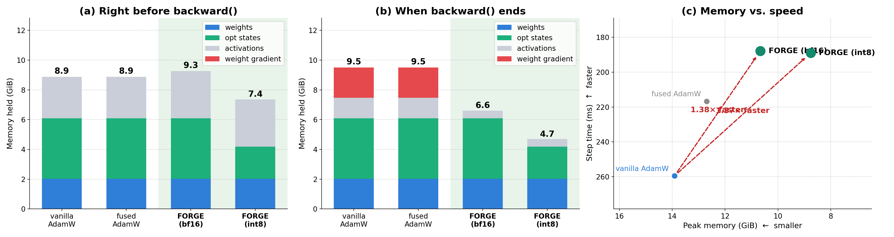
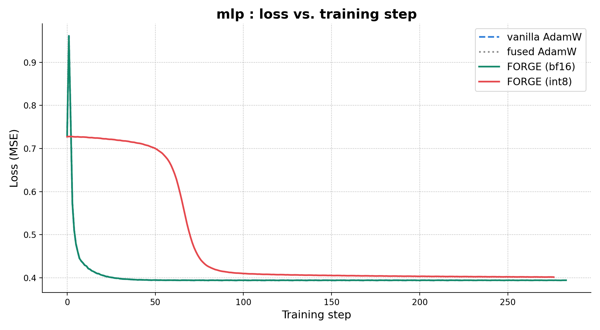
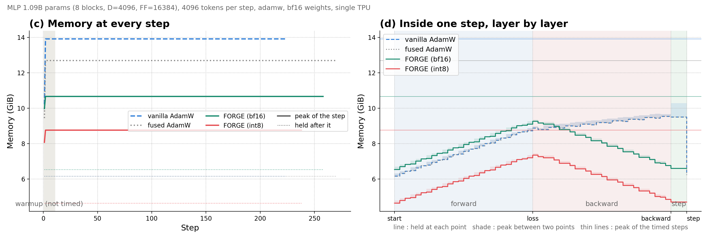

### Profile

#### MLP (adamw) : where the time of one step goes (ms, median of 20 steps)

| | vanilla AdamW | fused AdamW | FORGE (bf16) | FORGE (int8) |
|---|:--:|:--:|:--:|:--:|
| **Sync after each phase** | | | | |
| Forward | 68.8 | 68.7 | 68.7 | 68.7 |
| Backward : Python returns | 1.5 | 1.5 | 3.3 | 3.7 |
| Backward : TPU finishes | 123.6 | 123.5 | 118.1 | 119.2 |
| Optimizer step | 67.4 | 25.2 | 0.1 | 0.1 |
| Total | 259.8 | 217.5 | 186.8 | 188.0 |
| **As the benchmark (one sync at the end)** | | | | |
| Python done issuing | 3.5 | 2.7 | 4.8 | 5.1 |
| Step time (TPU done) | **257.8** | **215.5** | **186.2** | **187.3** |
| of which FORGE Python | - | - | 1.6 | 1.7 |
| FORGE updates per step | - | - | 17 | 17 |

#### MLP (adamw) : profile in detail (median of 20 steps, after 10 warmup steps)

| Method | Step as benchmark (ms) | Python done issuing (ms) | Forward : Python / TPU done | Backward : Python / TPU done | Step : Python / TPU done | FORGE Python (ms) |
|---|:--:|:--:|:--:|:--:|:--:|:--:|
| vanilla AdamW | 257.8 | 3.5 | 1.2 / 68.8 | 1.5 / 123.6 | 1.2 / 67.4 | 0.0 |
| fused AdamW | 215.5 | 2.7 | 1.0 / 68.7 | 1.5 / 123.5 | 0.4 / 25.2 | 0.0 |
| FORGE (bf16) | 186.2 | 4.8 | 1.7 / 68.7 | 3.3 / 118.1 | 0.0 / 0.1 | 1.6 |
| FORGE (int8) | 187.3 | 5.1 | 1.6 / 68.7 | 3.7 / 119.2 | 0.0 / 0.1 | 1.7 |

Host time per phase (ms, under the profiler), the 3 largest groups :

| Method | Forward | Backward | Step |
|---|---|---|---|
| vanilla AdamW | elementwise 0.5, Python, waiting (no op) 0.4, matmul 0.2 | Python, waiting (no op) 0.6, copies, new tensors 0.5, autograd engine 0.4 | optimizer 0.8, copies, new tensors 0.1, Python, waiting (no op) 0.0 |
| fused AdamW | elementwise 0.6, Python, waiting (no op) 0.4, matmul 0.2 | Python, waiting (no op) 0.5, copies, new tensors 0.5, autograd engine 0.4 | optimizer 0.3, Python, waiting (no op) 0.0, copies, new tensors 0.0 |
| FORGE (bf16) | elementwise 0.7, Python, waiting (no op) 0.6, matmul 0.3 | FORGE update (Python) 1.4, copies, new tensors 0.9, Python, waiting (no op) 0.6 | Python, waiting (no op) 0.0 |
| FORGE (int8) | elementwise 0.6, Python, waiting (no op) 0.4, matmul 0.3 | FORGE update (Python) 1.6, copies, new tensors 0.9, Python, waiting (no op) 0.6 | Python, waiting (no op) 0.0 |

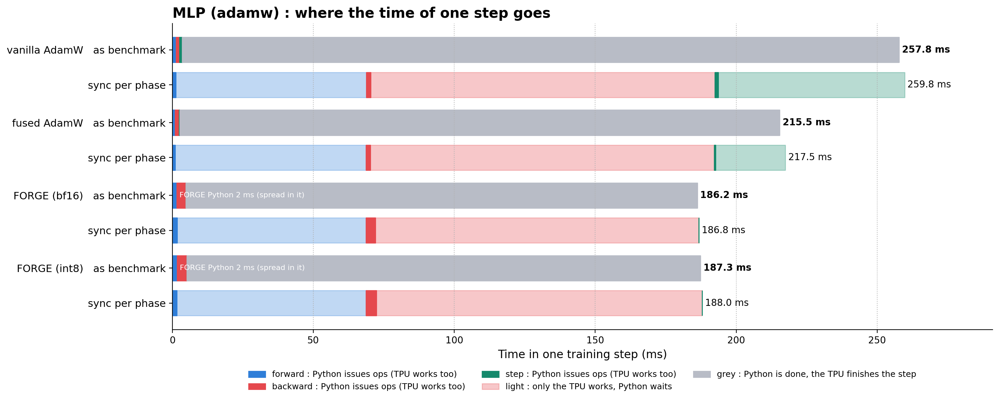
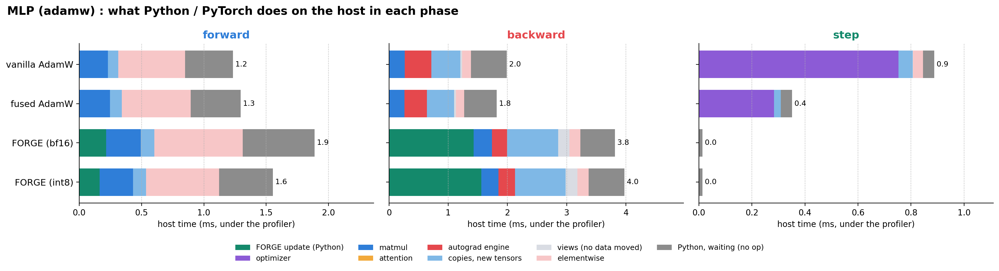

## Llama-3.2-1B

Llama-3.2-1B (transformers), 1.24B params (random init), batch 1, sequence 1024, adamw, bf16 weights, single TPU. Step time is the median of 210 steps (± std), after 10 warmup steps.

| Method | Peak (GiB) | Step (ms) | TF/s |
|---|:--:|:--:|:--:|
| vanilla AdamW | 12.04 | 226.1 ± 10.9 | 35 ± 2 |
| fused AdamW | 11.37 | 183.7 ± 20.1 | 44 ± 5 |
| FORGE (bf16) | 11.31 | 159.7 ± 15.7 | 50 ± 5 |
| FORGE (int8) | 9.57 | 159.1 ± 19.5 | 50 ± 6 |

| Method | Loss at step 218 (last common step) | max \|loss − vanilla AdamW\| (steps 1 to 218) |
|---|:--:|:--:|
| vanilla AdamW | 0.0426 | 0.0000 |
| fused AdamW | 0.0387 | 8.9854 |
| FORGE (bf16) | 0.0381 | 10.5057 |
| FORGE (int8) | 0.2533 | 7.5098 |

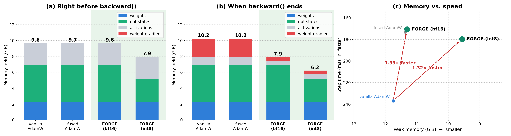
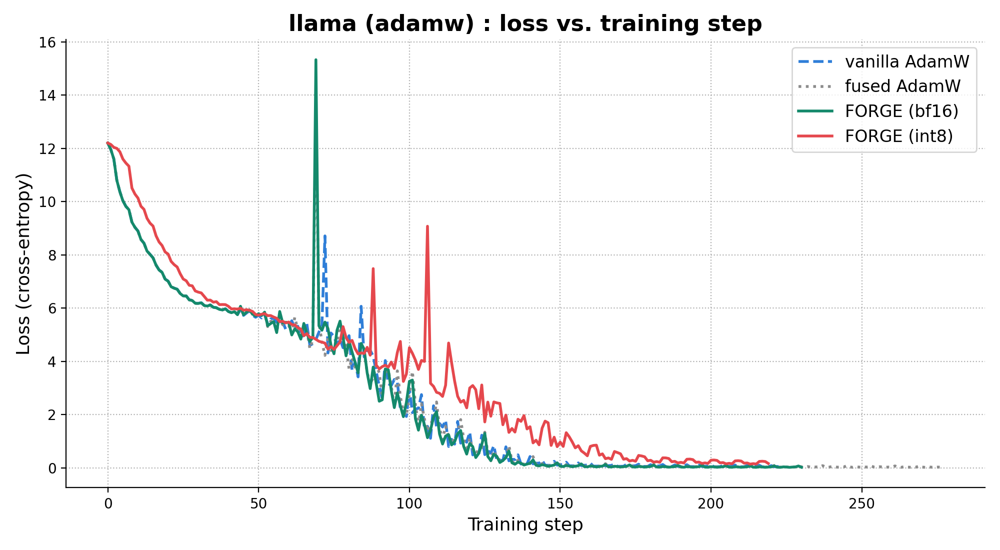
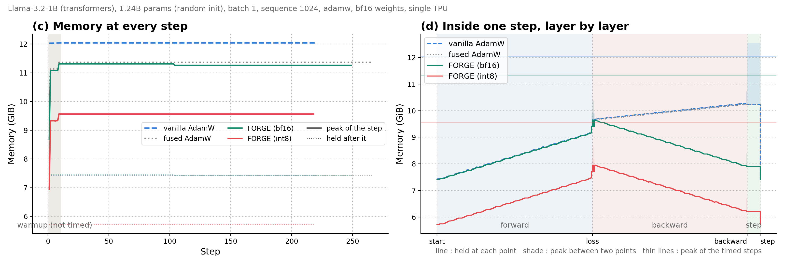

### Profile

#### Llama-3.2-1B (adamw) : where the time of one step goes (ms, median of 20 steps)

| | vanilla AdamW | fused AdamW | FORGE (bf16) | FORGE (int8) |
|---|:--:|:--:|:--:|:--:|
| **Sync after each phase** | | | | |
| Forward | 61.4 | 58.0 | 54.8 | 59.4 |
| Backward : Python returns | 36.7 | 39.2 | 64.0 | 57.7 |
| Backward : TPU finishes | 92.7 | 92.1 | 92.7 | 106.5 |
| Optimizer step | 79.2 | 31.4 | 7.7 | 7.9 |
| Total | 233.3 | 181.5 | 155.1 | 173.8 |
| **As the benchmark (one sync at the end)** | | | | |
| Python done issuing | 70.2 | 76.2 | 99.5 | 95.6 |
| Step time (TPU done) | **195.1** | **176.4** | **152.1** | **164.7** |
| of which FORGE Python | - | - | 16.2 | 15.1 |
| FORGE updates per step | - | - | 112 | 112 |

#### Llama-3.2-1B (adamw) : profile in detail (median of 20 steps, after 10 warmup steps)

| Method | Step as benchmark (ms) | Python done issuing (ms) | Forward : Python / TPU done | Backward : Python / TPU done | Step : Python / TPU done | FORGE Python (ms) |
|---|:--:|:--:|:--:|:--:|:--:|:--:|
| vanilla AdamW | 195.1 | 70.2 | 28.2 / 61.4 | 36.7 / 92.7 | 9.5 / 79.2 | 0.0 |
| fused AdamW | 176.4 | 76.2 | 32.8 / 58.0 | 39.2 / 92.1 | 2.5 / 31.4 | 0.0 |
| FORGE (bf16) | 152.1 | 99.5 | 34.9 / 54.8 | 64.0 / 92.7 | 1.2 / 7.7 | 16.2 |
| FORGE (int8) | 164.7 | 95.6 | 40.7 / 59.4 | 57.7 / 106.5 | 1.4 / 7.9 | 15.1 |

Host time per phase (ms, under the profiler), the 3 largest groups :

| Method | Forward | Backward | Step |
|---|---|---|---|
| vanilla AdamW | elementwise 13.1, copies, new tensors 6.8, Python, waiting (no op) 6.1 | elementwise 16.5, copies, new tensors 6.3, autograd engine 5.9 | optimizer 6.6, elementwise 0.3, copies, new tensors 0.1 |
| fused AdamW | elementwise 15.5, copies, new tensors 7.5, Python, waiting (no op) 6.8 | elementwise 21.1, copies, new tensors 8.3, autograd engine 7.8 | optimizer 2.3, copies, new tensors 0.2, Python, waiting (no op) 0.1 |
| FORGE (bf16) | elementwise 15.5, copies, new tensors 7.6, Python, waiting (no op) 7.2 | elementwise 24.2, FORGE update (Python) 14.5, copies, new tensors 10.3 | optimizer 1.1, copies, new tensors 0.1, Python, waiting (no op) 0.0 |
| FORGE (int8) | elementwise 17.9, copies, new tensors 8.6, Python, waiting (no op) 8.3 | elementwise 20.9, FORGE update (Python) 14.4, copies, new tensors 9.1 | optimizer 1.6, copies, new tensors 0.1, Python, waiting (no op) 0.1 |

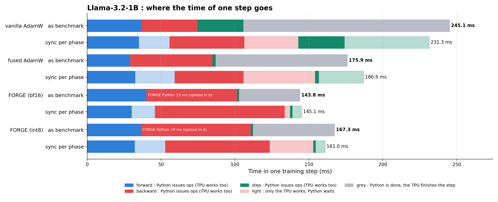
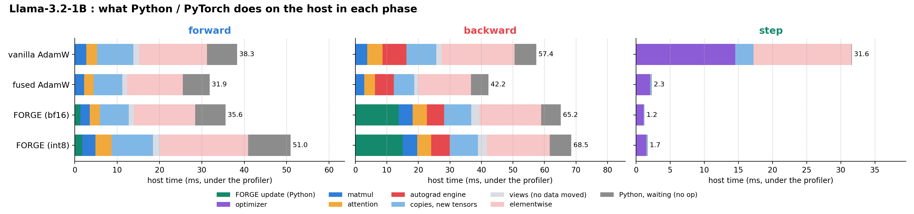

## Qwen3-0.6B

Qwen3-0.6B (transformers), 0.60B params (random init), batch 1, sequence 1024, adamw, bf16 weights, single TPU. Step time is the median of 990 steps (± std), after 10 warmup steps.

| Method | Peak (GiB) | Step (ms) | TF/s |
|---|:--:|:--:|:--:|
| vanilla AdamW | 8.14 | 394.0 ± 43.7 | 11 ± 1 |
| fused AdamW | 8.11 | 362.3 ± 39.3 | 12 ± 1 |
| FORGE (bf16) | 8.10 | 367.7 ± 36.3 | 12 ± 1 |
| FORGE (int8) | 7.33 | 371.0 ± 38.8 | 12 ± 1 |

| Method | Loss at step 1000 (last common step) | max \|loss − vanilla AdamW\| (steps 1 to 1000) |
|---|:--:|:--:|
| vanilla AdamW | 2.5772 | 0.0000 |
| fused AdamW | 6.0923 | 4.4498 |
| FORGE (bf16) | 0.2282 | 4.0127 |
| FORGE (int8) | 5.9495 | 12.6477 |

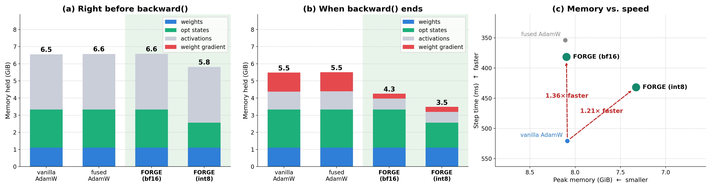
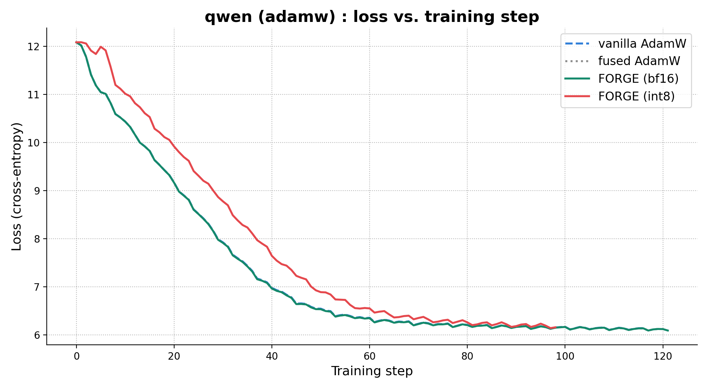
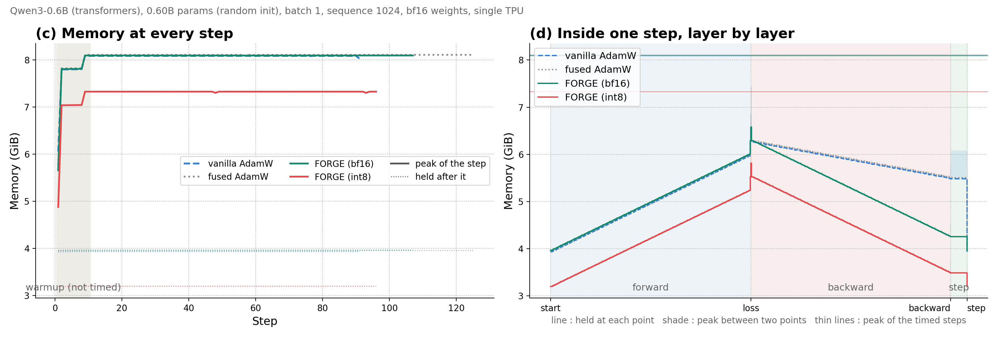

### Profile

#### Qwen3-0.6B (adamw) : where the time of one step goes (ms, median of 20 steps)

| | vanilla AdamW | fused AdamW | FORGE (bf16) | FORGE (int8) |
|---|:--:|:--:|:--:|:--:|
| **Sync after each phase** | | | | |
| Forward | 98.7 | 121.5 | 123.1 | 123.0 |
| Backward : Python returns | 114.1 | 107.9 | 158.7 | 134.9 |
| Backward : TPU finishes | 178.8 | 221.3 | 238.6 | 252.2 |
| Optimizer step | 44.8 | 26.2 | 9.5 | 9.0 |
| Total | 322.3 | 369.0 | 371.2 | 384.3 |
| **As the benchmark (one sync at the end)** | | | | |
| Python done issuing | 227.3 | 199.5 | 255.4 | 215.7 |
| Step time (TPU done) | **374.5** | **356.5** | **361.6** | **381.9** |
| of which FORGE Python | - | - | 28.5 | 25.7 |
| FORGE updates per step | - | - | 196 | 196 |

#### Qwen3-0.6B (adamw) : profile in detail (median of 20 steps, after 10 warmup steps)

| Method | Step as benchmark (ms) | Python done issuing (ms) | Forward : Python / TPU done | Backward : Python / TPU done | Step : Python / TPU done | FORGE Python (ms) |
|---|:--:|:--:|:--:|:--:|:--:|:--:|
| vanilla AdamW | 374.5 | 227.3 | 72.8 / 98.7 | 114.1 / 178.8 | 27.8 / 44.8 | 0.0 |
| fused AdamW | 356.5 | 199.5 | 74.0 / 121.5 | 107.9 / 221.3 | 6.1 / 26.2 | 0.0 |
| FORGE (bf16) | 361.6 | 255.4 | 99.8 / 123.1 | 158.7 / 238.6 | 3.0 / 9.5 | 28.5 |
| FORGE (int8) | 381.9 | 215.7 | 77.2 / 123.0 | 134.9 / 252.2 | 3.2 / 9.0 | 25.7 |

Host time per phase (ms, under the profiler), the 3 largest groups :

| Method | Forward | Backward | Step |
|---|---|---|---|
| vanilla AdamW | elementwise 34.7, copies, new tensors 19.2, Python, waiting (no op) 16.0 | elementwise 79.7, copies, new tensors 28.5, autograd engine 20.2 | optimizer 23.9, elementwise 0.9, copies, new tensors 0.4 |
| fused AdamW | elementwise 39.5, copies, new tensors 20.8, Python, waiting (no op) 17.9 | elementwise 75.3, copies, new tensors 26.1, autograd engine 18.1 | optimizer 7.6, copies, new tensors 0.5, Python, waiting (no op) 0.1 |
| FORGE (bf16) | elementwise 48.2, copies, new tensors 25.7, Python, waiting (no op) 24.3 | elementwise 74.5, copies, new tensors 29.1, FORGE update (Python) 26.6 | optimizer 4.1, copies, new tensors 0.2, Python, waiting (no op) 0.1 |
| FORGE (int8) | elementwise 38.5, copies, new tensors 21.0, Python, waiting (no op) 19.4 | elementwise 64.0, FORGE update (Python) 26.3, copies, new tensors 24.7 | optimizer 3.6, copies, new tensors 0.2, Python, waiting (no op) 0.1 |

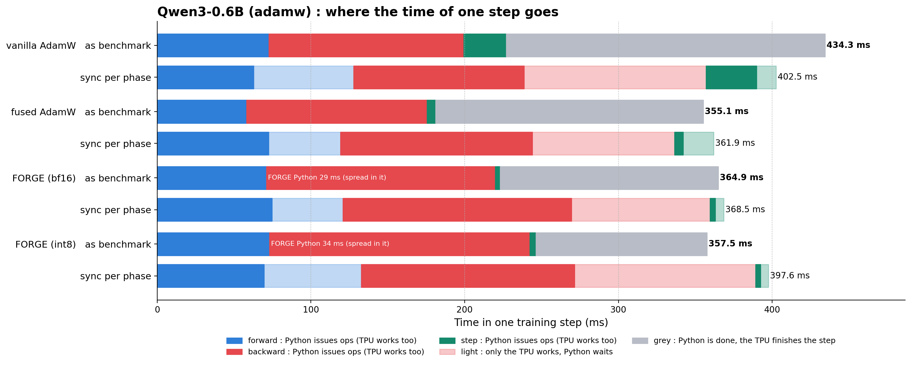
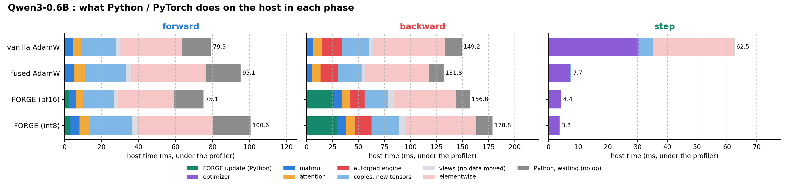
