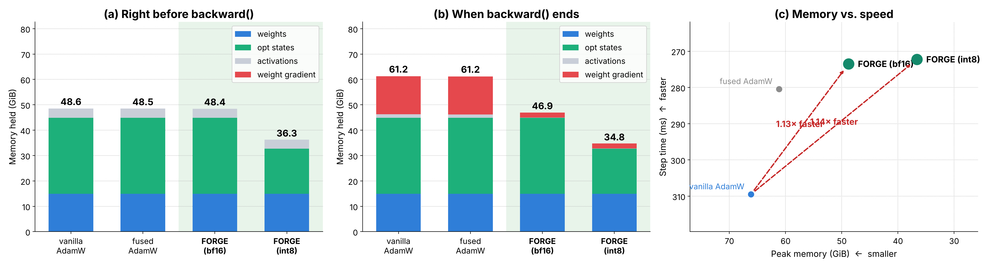
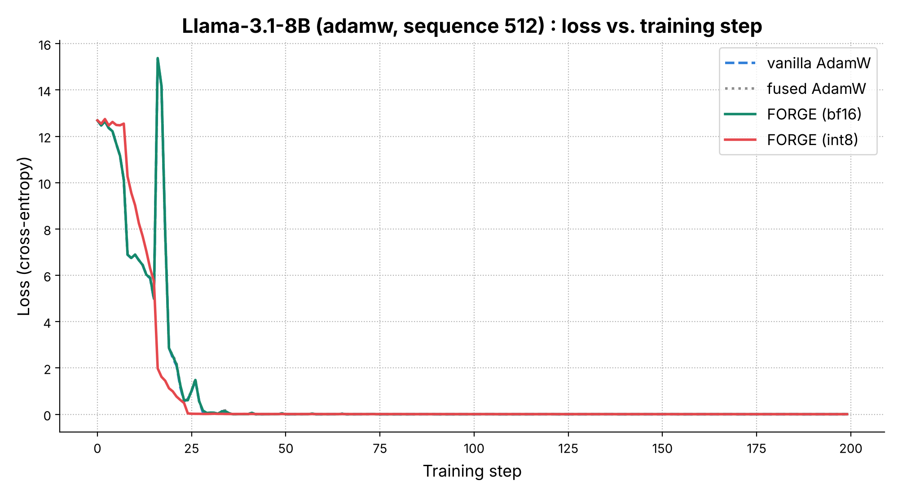
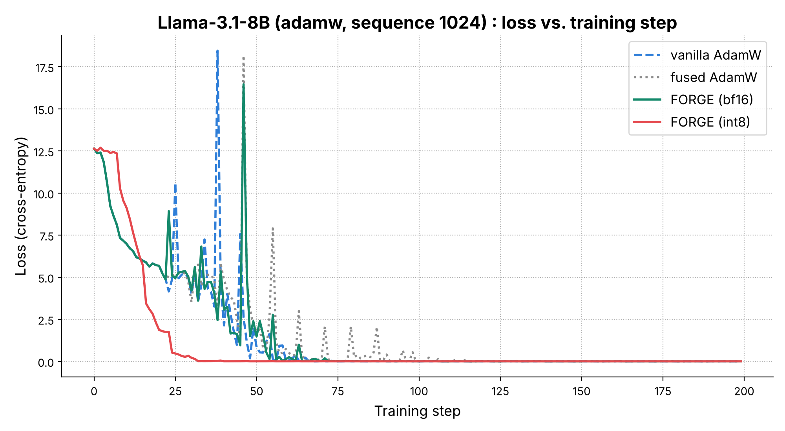
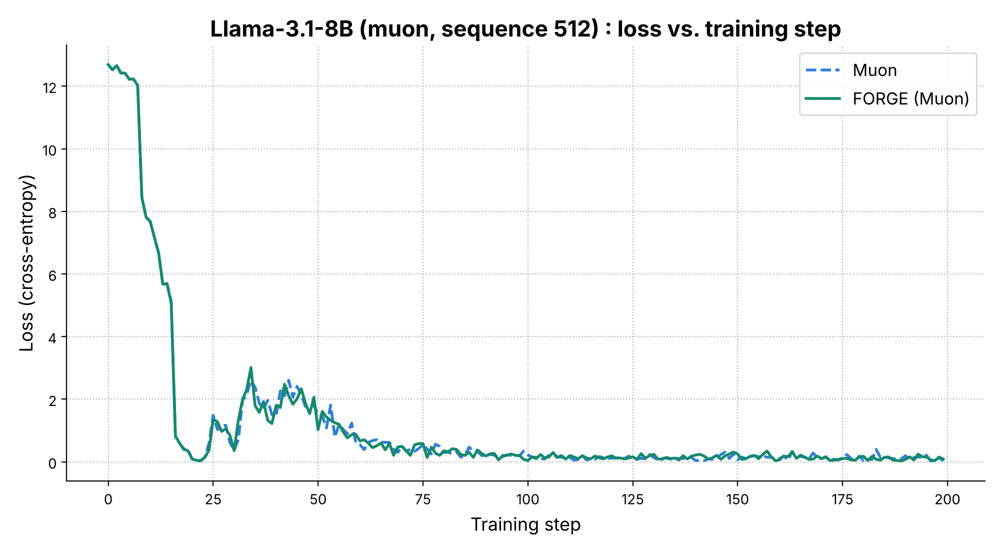
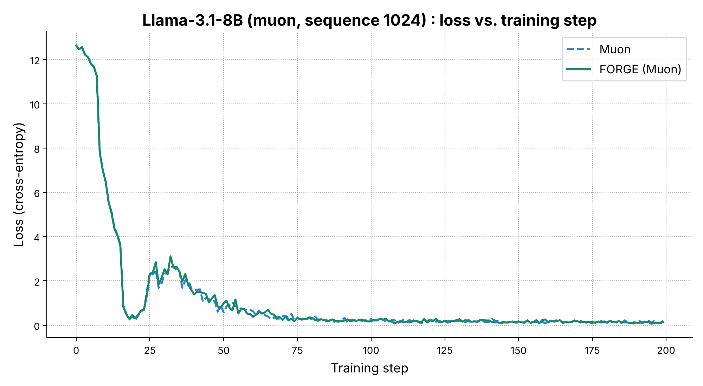

# 🔥 FORGE on TPU

### Fused On-Register Gradient Elimination on Google TPU v5e : Llama-3.1-8B

*The weight gradient is an artifact of how autograd is staged — not something learning needs. FORGE removes it, on TPU too.*

**📄 Paper · [FORGE: Fused On-Register Gradient Elimination for Memory-Efficient LLM Training](https://arxiv.org/abs/2606.22932)** · reference code : [dk4248/FORGE](https://github.com/dk4248/FORGE)

<b><a href="#-highlights">Highlights</a> · <a href="#-key-results-llama-31-8b-tpu-v5e-8">Results</a> · <a href="#-convergence-parity">Convergence</a> · <a href="#-against-the-other-forge-ports">Other ports</a> · <a href="#-correctness">Correctness</a> · <a href="#-how-it-ran">How it ran</a></b>

---

Standard training computes `grad_W = grad_output.T @ input` as a **full tensor in HBM**, then runs `optimizer.step()` to read it back. For an 8B model the live gradients alone cost ≈15 GB.

**FORGE fuses the optimizer step into the backward pass and applies it one tile at a time, inside the TPU's VMEM** (a Pallas kernel, `src/forge_tpu/kernel/`). Each weight-gradient tile is produced, consumed by AdamW (or Muon's momentum), and dropped. **The full `grad_W` never exists in HBM.**

Llama-3.1-8B does not fit on one 16 GB TPU v5e chip, so it runs on **8 chips with tensor parallelism** (Kaggle TPU v5e-8, `kaggle/`). Every chip runs the unchanged FORGE kernel on its 1/8 of each weight. **All memory below is converted to one device** (one HBM, as a single-GPU run) so it compares with the FORGE paper : see [How it ran](#-how-it-ran).

## ✨ Highlights

- **Deletes the gradient pool** — on Llama-3.1-8B (sequence 512), peak memory falls from **65.7 GB under fused AdamW to 52.4 GB** at matched state precision, and to **39.3 GB with int8 moments**.
- **Faster, not slower** — the update is folded into the weight-gradient kernel, so the separate `optimizer.step()` disappears : **273.5 ms/step vs. 280.4 (fused AdamW) and 309.5 (vanilla)** — **1.13× faster** than vanilla AdamW.
- **Muon too** — the momentum accumulate `B = 0.95 B + G` is fused into the dW tile, Newton–Schulz runs after backward (as in the paper) : **60.5 → 50.3 GB** (-16.8%), step -4.0% (sequence 512).
- **Correct** — every method passes the 8-chip check (tensor parallel against the same model on one chip) and the FORGE-vs-PyTorch tests on one chip (int8 : approximate by design).

## 📊 Key results (Llama-3.1-8B, TPU v5e-8)

 <em>The weight gradient (red) collapses under FORGE; its two arms differ only in moment precision. Sequence 512, memory of one device.</em>

AdamW : TPU v5e-8 (8 chips, tensor parallel), batch 1, sequence 512, BF16 everywhere; step time is the median of 190 steps; peak memory of one device.

| Method | Peak (GB) | Step (ms) | TF/s |
|---|:--:|:--:|:--:|
| vanilla AdamW | 71.04 | 309.5 ± 18.5 | 81 ± 4 |
| fused AdamW | 65.69 | 280.4 ± 12.7 | 89 ± 4 |
| **FORGE (bf16)** | **52.37** | **273.5 ± 13.7** | **92 ± 4** |
| **FORGE (int8)** | **39.31** | **272.2 ± 15.1** | **92 ± 5** |

AdamW : TPU v5e-8 (8 chips, tensor parallel), batch 1, sequence 1024, BF16 everywhere; step time is the median of 190 steps; peak memory of one device.

| Method | Peak (GB) | Step (ms) | TF/s |
|---|:--:|:--:|:--:|
| vanilla AdamW | 72.32 | 324.0 ± 11.0 | 157 ± 5 |
| fused AdamW | 66.98 | 285.8 ± 12.8 | 178 ± 8 |
| **FORGE (bf16)** | **56.55** | **272.8 ± 10.9** | **187 ± 7** |
| **FORGE (int8)** | **43.49** | **279.9 ± 13.4** | **182 ± 8** |

Muon : TPU v5e-8 (8 chips, tensor parallel), batch 1, sequence 512, BF16 everywhere; step time is the median of 190 steps; peak memory of one device.

| Method | Peak (GB) | Step (ms) | TF/s |
|---|:--:|:--:|:--:|
| Muon (standard) | 60.54 | 2439.7 ± 21.2 | 10 ± 0 |
| **FORGE (Muon)** | **50.34** | **2342.0 ± 15.5** | **11 ± 0** |

Muon : TPU v5e-8 (8 chips, tensor parallel), batch 1, sequence 1024, BF16 everywhere; step time is the median of 190 steps; peak memory of one device.

| Method | Peak (GB) | Step (ms) | TF/s |
|---|:--:|:--:|:--:|
| Muon (standard) | 61.64 | 2456.2 ± 20.1 | 21 ± 0 |
| **FORGE (Muon)** | **50.37** | **2343.5 ± 18.9** | **22 ± 0** |

**FORGE improves on fused AdamW on memory and step time at once** — and int8 moments cut the memory further at the same speed.

**Operating regime.** FORGE deletes a fixed gradient pool (≈15 GB here), so the saving is `max(0, G − A)` where `A` are the activations alive when the pool is complete : it shrinks as the sequence grows (-20.3% at 512, -15.6% at 1024). FORGE is a small-`BT` method. int8 moments save on top of it at every length.

## 📉 Convergence parity

   
 <em>8 fixed batches, cycled : the model memorises them. FORGE tracks its baseline (fused AdamW, standard Muon).</em>

- **FORGE (bf16)**, sequence 512 : final loss 0.0025 vs. 0.0025 (fused AdamW); within 0.05 of it for the first 16 steps.
- **FORGE (int8)**, sequence 512 : final loss 0.0059 vs. 0.0025 (fused AdamW); within 0.05 of it for the first 1 steps.
- **FORGE (bf16)**, sequence 1024 : final loss 0.0036 vs. 0.0058 (fused AdamW); within 0.05 of it for the first 23 steps.
- **FORGE (int8)**, sequence 1024 : final loss 0.0072 vs. 0.0058 (fused AdamW); within 0.05 of it for the first 1 steps.
- **FORGE (Muon)**, sequence 512 : final loss 0.0894 vs. 0.0292 (Muon (standard)); within 0.05 of it for the first 15 steps.
- **FORGE (Muon)**, sequence 1024 : final loss 0.1401 vs. 0.1844 (Muon (standard)); within 0.05 of it for the first 12 steps.
- Memorising 8 fixed sequences in bf16 is chaotic : vanilla and fused AdamW also leave each other after a few dozen steps, so the curves are compared, not the last digits.

## 🔁 Against the other FORGE ports

Llama-3.1-8B, AdamW, batch 1, one device. Step time : the change against fused AdamW on the same hardware.

| Port | Hardware | Seq | fused AdamW (GB) | FORGE (GB) | FORGE int8 (GB) | FORGE step vs. fused AdamW |
|---|---|:--:|:--:|:--:|:--:|:--:|
| FORGE paper (Dikshant) | 1 x H200 | 512 | 60.1 | 48.4 (-19.5%) | 35.3 (-41.2%) | -17.9% |
| Forge_AMD_v2 (friend) | 1 x MI300X | 512 | 64.4 | 52.7 (-18.2%) | — | — |
| Forge_AMD_v2 (friend) | 1 x MI300X | 1024 | 64.4 | 57.0 (-11.5%) | — | +4.8% |
| **TRAVELLER** | 8 × TPU v5e | 512 | 65.7 | **52.4 (-20.3%)** | **39.3 (-40.2%)** | **-2.5%** |
| **TRAVELLER** | 8 × TPU v5e | 1024 | 67.0 | **56.5 (-15.6%)** | **43.5 (-35.1%)** | **-4.6%** |

## ✅ Correctness

- **adamw** — 8-chip check : every method in tensor parallel against the same model on one chip (gradients and updates) : **all pass** · [report](adamw/smoke_adamw.md)
- **adamw** — `benchmarks/tests.py` on one chip : FORGE against PyTorch : **154 / 160 checks pass** (the fails are the int8 cases : 4 cases) · [report](adamw/tests/tests_report.md)
- **muon** — 8-chip check : every method in tensor parallel against the same model on one chip (gradients and updates) : **all pass** · [report](muon/smoke_muon.md)
- **muon** — `benchmarks/tests.py` on one chip : FORGE against PyTorch : **72 / 72 checks pass** · [report](muon/tests/tests_report.md)

## 🧪 How it ran

| | |
|---|---|
| Hardware | Kaggle TPU v5e-8 : 8 chips, 16 GB HBM each, one process per chip (torchrun) |
| Software | torch 2.13.0, torch_tpu 0.3.0, jax 0.12.0.1 (Pallas), transformers 5.23.0 |
| Model | Llama-3.1-8B config (8.03B), random init, untied head. FORGE on every Linear of the 32 layers; embedding, lm_head, norms on fused AdamW |
| Tensor parallel | q, k, v, gate, up, lm_head split by rows; o, down by columns; vocabulary-parallel embedding and cross-entropy (`kaggle/tp.py`) |
| Muon | `B = 0.95 B + G` fused in the dW tile, 5 Newton–Schulz steps after backward, gathered over the chips (FORGE paper App. I.1); lr 0.02, wd 0.01, scale √max(1, rows/cols) (Keller Jordan's Muon) |
| Run | 200 steps per method (10 warmup), batch 1, 8 fixed batches cycled, `kaggle/kaggle_cell.py` |

**One device.** Each chip holds exactly 1/8 of the weights, optimizer states and weight gradient : those are × 8. The activations are mostly the same on every chip (residual stream, norms), so they are × 2.64 : the ratio of one-device to one-chip activations, measured from the MI300X port's one-device run of the same model and data (it is the same at sequence 512 and 1024). `kaggle/one_device.py` converts every memory point of every run and remakes the plots. The per-chip numbers of the run are in each `*_table.md` and in the json files.

Profile (where the time of one step goes) : [adamw, sequence 512](adamw/llama8b_seq512/profile_llama8b_seq512_table.md) · [adamw, sequence 1024](adamw/llama8b_seq1024/profile_llama8b_seq1024_table.md).

Runs : `smoke_adamw` ✓, `smoke_muon` ✓, `tests_adamw` ✓, `bench_adamw_llama8b_seq512_adamw` ✓, `bench_adamw_llama8b_seq512_adamw_fused` ✓, `bench_adamw_llama8b_seq512_forge_bf16` ✓, `bench_adamw_llama8b_seq512_forge_int8` ✓, `bench_adamw_llama8b_seq1024_adamw` ✓, `bench_adamw_llama8b_seq1024_adamw_fused` ✓, `bench_adamw_llama8b_seq1024_forge_bf16` ✓, `bench_adamw_llama8b_seq1024_forge_int8` ✓, `tests_muon` ✓, `bench_muon_llama8b_seq512_muon` ✓, `bench_muon_llama8b_seq512_forge_muon` ✓, `bench_muon_llama8b_seq1024_muon` ✓, `bench_muon_llama8b_seq1024_forge_muon` ✓, `profile_adamw_llama8b_seq512_adamw` ✓, `profile_adamw_llama8b_seq512_adamw_fused` ✓, `profile_adamw_llama8b_seq512_forge_bf16` ✓, `profile_adamw_llama8b_seq512_forge_int8` ✓, `profile_adamw_llama8b_seq1024_adamw` ✓, `profile_adamw_llama8b_seq1024_adamw_fused` ✓, `profile_adamw_llama8b_seq1024_forge_bf16` ✓, `profile_adamw_llama8b_seq1024_forge_int8` ✓
