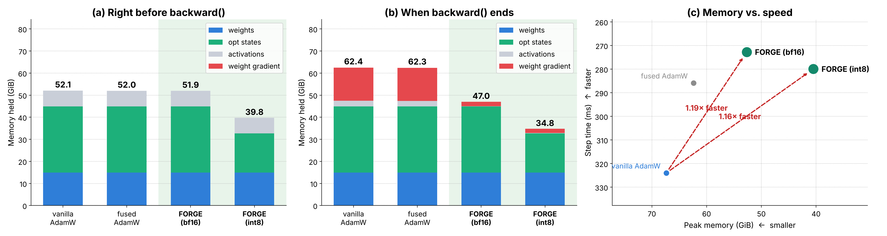
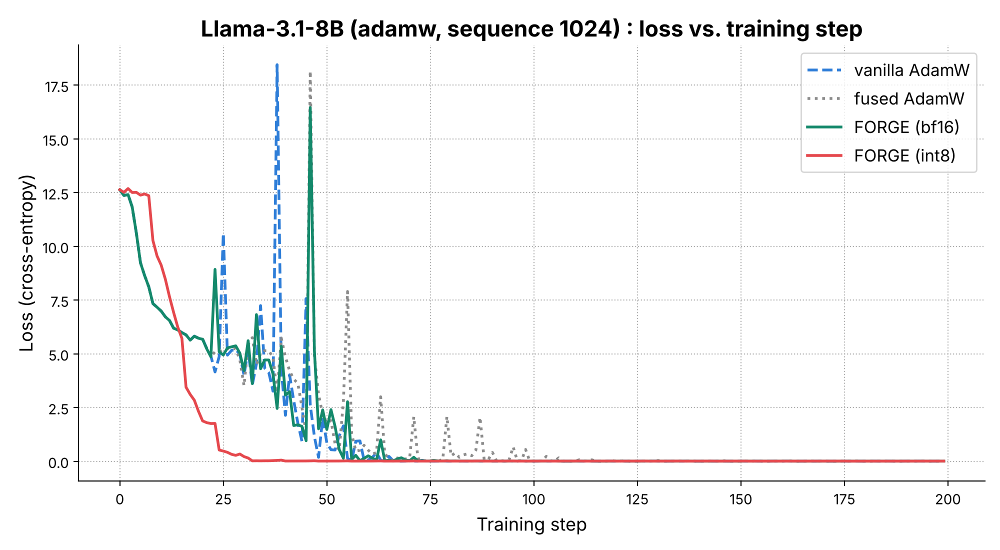
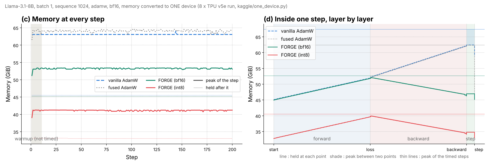
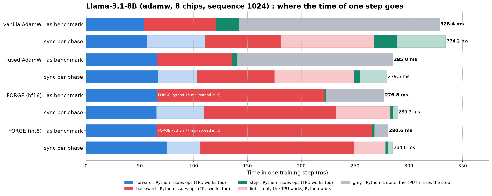
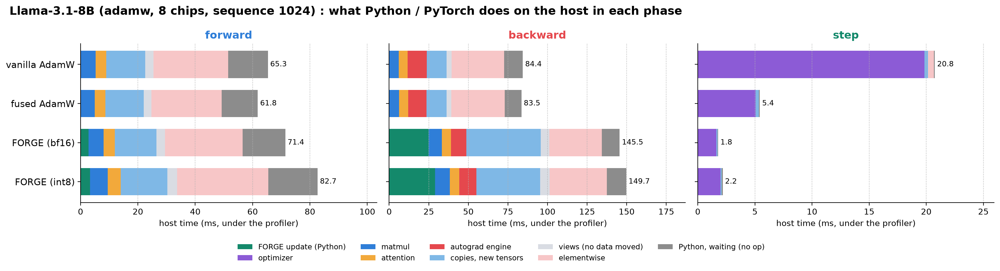
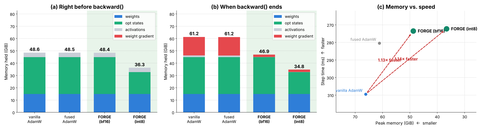
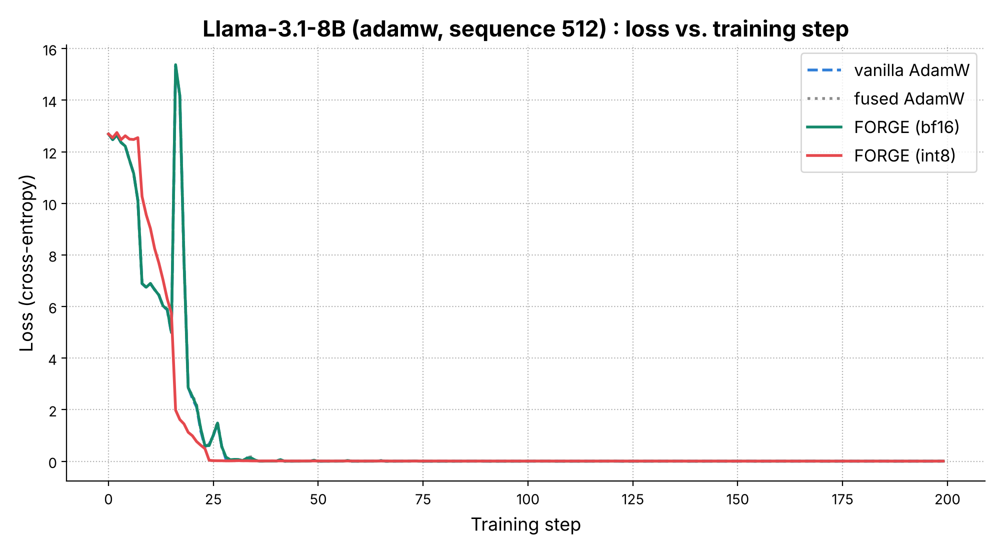
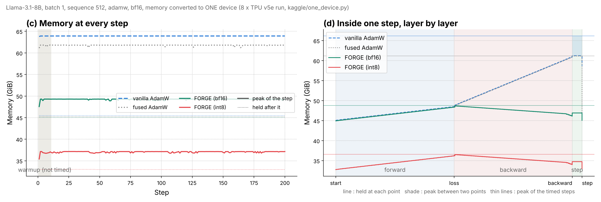
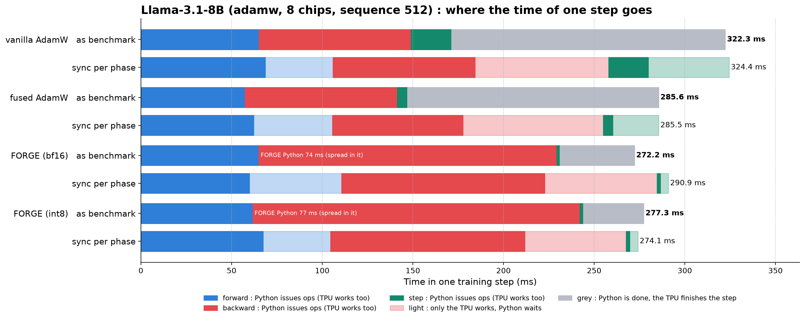
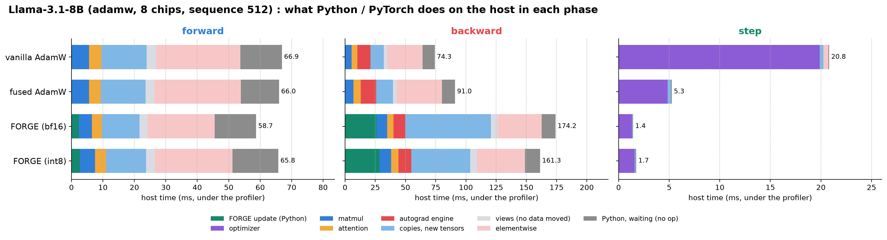

# AdamW results (TPU v5e-8, tensor parallel over 8 chips)

Written by `benchmarks/readme.py` from the files in this folder. Do not edit by hand.

## Llama-3.1-8B, sequence 1024

Llama-3.1-8B, sequence 1024, 8.03B params, adamw. Step time : median (± std) of 190 timed steps of each run, after 10 warmup steps. Peak : the largest step peak above the data, on the chip with the largest one. TF/s : the 8 chips together (peak 8 x 197).

| Method | Peak (GiB) | Step (ms) | TF/s |
|---|:--:|:--:|:--:|
| vanilla AdamW | 9.65 | 324.0 ± 11.0 | 157 ± 5 |
| fused AdamW | 8.94 | 285.8 ± 12.8 | 178 ± 8 |
| FORGE (bf16) | 8.84 | 272.8 ± 10.9 | 187 ± 7 |
| FORGE (int8) | 7.33 | 279.9 ± 13.4 | 182 ± 8 |

| Method | Loss at step 200 (last common step) | max \|loss − vanilla AdamW\| (steps 1 to 200) |
|---|:--:|:--:|
| vanilla AdamW | 0.0017 | 0.0000 |
| fused AdamW | 0.0058 | 15.5372 |
| FORGE (bf16) | 0.0036 | 15.9992 |
| FORGE (int8) | 0.0072 | 18.4168 |

### Profile

#### Llama-3.1-8B (adamw, 8 chips, sequence 1024) : where the time of one step goes (ms, median of 20 steps)

| | vanilla AdamW | fused AdamW | FORGE (bf16) | FORGE (int8) |
|---|:--:|:--:|:--:|:--:|
| **Sync after each phase** | | | | |
| Forward | 111.0 | 103.5 | 109.7 | 106.4 |
| Backward : Python returns | 69.5 | 71.3 | 122.5 | 142.5 |
| Backward : TPU finishes | 157.1 | 146.0 | 173.4 | 172.1 |
| Optimizer step | 66.1 | 30.0 | 6.2 | 6.3 |
| Total | 334.2 | 279.5 | 289.3 | 284.8 |
| **As the benchmark (one sync at the end)** | | | | |
| Python done issuing | 142.2 | 140.8 | 223.4 | 268.2 |
| Step time (TPU done) | **328.4** | **285.0** | **276.8** | **280.6** |
| of which FORGE Python | - | - | 75.3 | 77.1 |
| FORGE updates per step | - | - | 224 | 224 |

#### Llama-3.1-8B (adamw, 8 chips, sequence 1024) : profile in detail (median of 20 steps, after 10 warmup steps)

| Method | Step as benchmark (ms) | Python done issuing (ms) | Forward : Python / TPU done | Backward : Python / TPU done | Step : Python / TPU done | FORGE Python (ms) |
|---|:--:|:--:|:--:|:--:|:--:|:--:|
| vanilla AdamW | 328.4 | 142.2 | 56.3 / 111.0 | 69.5 / 157.1 | 20.9 / 66.1 | 0.0 |
| fused AdamW | 285.0 | 140.8 | 66.5 / 103.5 | 71.3 / 146.0 | 5.0 / 30.0 | 0.0 |
| FORGE (bf16) | 276.8 | 223.4 | 65.1 / 109.7 | 122.5 / 173.4 | 1.7 / 6.2 | 75.3 |
| FORGE (int8) | 280.6 | 268.2 | 74.6 / 106.4 | 142.5 / 172.1 | 1.8 / 6.3 | 77.1 |

Host time per phase (ms, under the profiler), the 3 largest groups :

| Method | Forward | Backward | Step |
|---|---|---|---|
| vanilla AdamW | elementwise 26.0, Python, waiting (no op) 13.8, copies, new tensors 13.6 | elementwise 33.2, copies, new tensors 12.7, autograd engine 12.1 | optimizer 19.8, elementwise 0.5, copies, new tensors 0.3 |
| fused AdamW | elementwise 24.5, copies, new tensors 13.3, Python, waiting (no op) 12.6 | elementwise 33.8, copies, new tensors 12.7, autograd engine 11.5 | optimizer 5.1, copies, new tensors 0.3, Python, waiting (no op) 0.1 |
| FORGE (bf16) | elementwise 27.1, Python, waiting (no op) 14.8, copies, new tensors 14.5 | copies, new tensors 47.0, elementwise 33.1, FORGE update (Python) 24.9 | optimizer 1.6, copies, new tensors 0.1, Python, waiting (no op) 0.1 |
| FORGE (int8) | elementwise 31.8, Python, waiting (no op) 17.2, copies, new tensors 16.3 | copies, new tensors 40.4, elementwise 36.2, FORGE update (Python) 29.0 | optimizer 2.0, copies, new tensors 0.1, Python, waiting (no op) 0.1 |

## Llama-3.1-8B, sequence 512

Llama-3.1-8B, sequence 512, 8.03B params, adamw. Step time : median (± std) of 190 timed steps of each run, after 10 warmup steps. Peak : the largest step peak above the data, on the chip with the largest one. TF/s : the 8 chips together (peak 8 x 197).

| Method | Peak (GiB) | Step (ms) | TF/s |
|---|:--:|:--:|:--:|
| vanilla AdamW | 9.43 | 309.5 ± 18.5 | 81 ± 4 |
| fused AdamW | 8.08 | 280.4 ± 12.7 | 89 ± 4 |
| FORGE (bf16) | 7.29 | 273.5 ± 13.7 | 92 ± 4 |
| FORGE (int8) | 5.78 | 272.2 ± 15.1 | 92 ± 5 |

| Method | Loss at step 200 (last common step) | max \|loss − vanilla AdamW\| (steps 1 to 200) |
|---|:--:|:--:|
| vanilla AdamW | 0.0024 | 0.0000 |
| fused AdamW | 0.0025 | 0.1466 |
| FORGE (bf16) | 0.0025 | 0.0916 |
| FORGE (int8) | 0.0059 | 13.3512 |

### Profile

#### Llama-3.1-8B (adamw, 8 chips, sequence 512) : where the time of one step goes (ms, median of 20 steps)

| | vanilla AdamW | fused AdamW | FORGE (bf16) | FORGE (int8) |
|---|:--:|:--:|:--:|:--:|
| **Sync after each phase** | | | | |
| Forward | 105.9 | 105.6 | 110.7 | 104.6 |
| Backward : Python returns | 78.3 | 72.0 | 112.0 | 107.1 |
| Backward : TPU finishes | 152.1 | 149.4 | 174.1 | 163.0 |
| Optimizer step | 66.3 | 30.5 | 6.2 | 6.5 |
| Total | 324.4 | 285.5 | 290.9 | 274.1 |
| **As the benchmark (one sync at the end)** | | | | |
| Python done issuing | 171.3 | 147.1 | 231.2 | 244.1 |
| Step time (TPU done) | **322.3** | **285.6** | **272.2** | **277.3** |
| of which FORGE Python | - | - | 74.5 | 76.6 |
| FORGE updates per step | - | - | 224 | 224 |

#### Llama-3.1-8B (adamw, 8 chips, sequence 512) : profile in detail (median of 20 steps, after 10 warmup steps)

| Method | Step as benchmark (ms) | Python done issuing (ms) | Forward : Python / TPU done | Backward : Python / TPU done | Step : Python / TPU done | FORGE Python (ms) |
|---|:--:|:--:|:--:|:--:|:--:|:--:|
| vanilla AdamW | 322.3 | 171.3 | 68.6 / 105.9 | 78.3 / 152.1 | 21.8 / 66.3 | 0.0 |
| fused AdamW | 285.6 | 147.1 | 62.2 / 105.6 | 72.0 / 149.4 | 5.2 / 30.5 | 0.0 |
| FORGE (bf16) | 272.2 | 231.2 | 59.7 / 110.7 | 112.0 / 174.1 | 1.7 / 6.2 | 74.5 |
| FORGE (int8) | 277.3 | 244.1 | 67.3 / 104.6 | 107.1 / 163.0 | 1.9 / 6.5 | 76.6 |

Host time per phase (ms, under the profiler), the 3 largest groups :

| Method | Forward | Backward | Step |
|---|---|---|---|
| vanilla AdamW | elementwise 26.7, copies, new tensors 14.4, Python, waiting (no op) 13.3 | elementwise 29.2, copies, new tensors 11.1, autograd engine 11.0 | optimizer 19.9, elementwise 0.5, copies, new tensors 0.4 |
| fused AdamW | elementwise 27.4, copies, new tensors 14.2, Python, waiting (no op) 12.2 | elementwise 37.4, copies, new tensors 13.8, autograd engine 12.6 | optimizer 4.9, copies, new tensors 0.3, Python, waiting (no op) 0.1 |
| FORGE (bf16) | elementwise 21.3, Python, waiting (no op) 13.2, copies, new tensors 12.0 | copies, new tensors 70.9, elementwise 36.4, FORGE update (Python) 26.0 | optimizer 1.3, copies, new tensors 0.1, Python, waiting (no op) 0.0 |
| FORGE (int8) | elementwise 24.7, Python, waiting (no op) 14.6, copies, new tensors 12.8 | copies, new tensors 48.7, elementwise 39.6, FORGE update (Python) 28.6 | optimizer 1.6, copies, new tensors 0.1, Python, waiting (no op) 0.1 |

# 8-chip checks (adamw)

- chips (processes) : 8, devices seen by each process : ? (RuntimeError)
- all_reduce sum of rank+1 : 36.0 (want 36.0), bf16 : 36.0, all_gather of rank : [0.0, 1.0, 2.0, 3.0, 4.0, 5.0, 6.0, 7.0] -> PASS
- memory of each chip after 256 MiB on each (MiB) : [0, 0, 0, 0, 0, 0, 0, 0]

TP check : each small model in tensor parallel over the 8 chips against the same model on one chip (same weights and data), one step at lr 1e-2. Pass : gradient error (max |TP - 1 chip| / max |1 chip|, each tensor) <= 0.05, update error (|change TP - change 1 chip| / |change 1 chip|, each tensor) <= 0.5, the replicated (norm) weights equal on all chips.

| model | method | max gradient error | max update error | loss TP (4 steps) | loss 1 chip | replicated weights equal | result |
|---|---|---|---|---|---|---|---|
| Llama-3.1-8B (small) | adamw | 1.73e-02 | 2.11e-01 | 7.6206 7.6607 7.7612 7.9346 | 7.6203 7.6629 7.7569 8.0170 | yes | PASS |
| Llama-3.1-8B (small) | adamw_fused | 1.73e-02 | 2.11e-01 | 7.6206 7.6604 7.7607 7.9311 | 7.6203 7.6627 7.7566 8.0106 | yes | PASS |
| Llama-3.1-8B (small) | forge_bf16 | 1.69e-02 | 2.11e-01 | 7.6206 7.6605 7.7610 7.9343 | 7.6203 7.6627 7.7564 8.0094 | yes | PASS |
| Llama-3.1-8B (small) | forge_int8 | 1.69e-02 | 2.11e-01 | 7.6206 7.6510 7.7675 8.0596 | 7.6203 7.6521 7.7674 8.0495 | yes | PASS |

**ALL PASS**

# FORGE correctness (adamw) : 154 / 160 checks pass

| case | check | error | tolerance | result |
|---|---|--:|--:|:--:|
| module : from_linear, eval | shares weight (0 = yes) | 0 | 0 | PASS |
| module : from_linear, eval | eval out = F.linear | 0 | 0 | PASS |
| step adamw bf16 state, float32 w, 128x256x128 | y | 0.00266 | 0.005 | PASS |
| step adamw bf16 state, float32 w, 128x256x128 | dx | 0.00237 | 0.005 | PASS |
| step adamw bf16 state, float32 w, 128x256x128 | w(rel) | 1.48e-05 | 0.005 | PASS |
| step adamw bf16 state, float32 w, 128x256x128 | m | 1 | 1 | PASS |
| step adamw bf16 state, float32 w, 128x256x128 | v | 0 | 1 | PASS |
| step adamw bf16 state, float32 w, 64x512x256 | y | 0.00289 | 0.005 | PASS |
| step adamw bf16 state, float32 w, 64x512x256 | dx | 0.00244 | 0.005 | PASS |
| step adamw bf16 state, float32 w, 64x512x256 | w(rel) | 1.47e-05 | 0.005 | PASS |
| step adamw bf16 state, float32 w, 64x512x256 | m | 1 | 1 | PASS |
| step adamw bf16 state, float32 w, 64x512x256 | v | 0 | 1 | PASS |
| step adamw bf16 state, float32 w, 256x1024x512 | y | 0.00234 | 0.005 | PASS |
| step adamw bf16 state, float32 w, 256x1024x512 | dx | 0.00241 | 0.005 | PASS |
| step adamw bf16 state, float32 w, 256x1024x512 | w(rel) | 1.47e-05 | 0.005 | PASS |
| step adamw bf16 state, float32 w, 256x1024x512 | m | 1 | 1 | PASS |
| step adamw bf16 state, float32 w, 256x1024x512 | v | 1 | 1 | PASS |
| step adamw bf16 state, float32 w, 1500x1536x2048 | y | 0.00253 | 0.005 | PASS |
| step adamw bf16 state, float32 w, 1500x1536x2048 | dx | 0.00246 | 0.005 | PASS |
| step adamw bf16 state, float32 w, 1500x1536x2048 | w(rel) | 7.35e-06 | 0.005 | PASS |
| step adamw bf16 state, float32 w, 1500x1536x2048 | m | 1 | 1 | PASS |
| step adamw bf16 state, float32 w, 1500x1536x2048 | v | 1 | 1 | PASS |
| step adamw bf16 state, bfloat16 w, 128x256x128 | y | 0.00313 | 0.005 | PASS |
| step adamw bf16 state, bfloat16 w, 128x256x128 | dx | 0.00246 | 0.005 | PASS |
| step adamw bf16 state, bfloat16 w, 128x256x128 | w(ulp) | 0 | 1 | PASS |
| step adamw bf16 state, bfloat16 w, 128x256x128 | m | 1 | 1 | PASS |
| step adamw bf16 state, bfloat16 w, 128x256x128 | v | 0 | 1 | PASS |
| step adamw bf16 state, bfloat16 w, 64x512x256 | y | 0.00256 | 0.005 | PASS |
| step adamw bf16 state, bfloat16 w, 64x512x256 | dx | 0.00273 | 0.005 | PASS |
| step adamw bf16 state, bfloat16 w, 64x512x256 | w(ulp) | 0 | 1 | PASS |
| step adamw bf16 state, bfloat16 w, 64x512x256 | m | 1 | 1 | PASS |
| step adamw bf16 state, bfloat16 w, 64x512x256 | v | 0 | 1 | PASS |
| step adamw bf16 state, bfloat16 w, 256x1024x512 | y | 0.00296 | 0.005 | PASS |
| step adamw bf16 state, bfloat16 w, 256x1024x512 | dx | 0.00237 | 0.005 | PASS |
| step adamw bf16 state, bfloat16 w, 256x1024x512 | w(ulp) | 0.0182 | 1 | PASS |
| step adamw bf16 state, bfloat16 w, 256x1024x512 | m | 1 | 1 | PASS |
| step adamw bf16 state, bfloat16 w, 256x1024x512 | v | 1 | 1 | PASS |
| step adamw bf16 state, bfloat16 w, 1500x1536x2048 | y | 0.00302 | 0.005 | PASS |
| step adamw bf16 state, bfloat16 w, 1500x1536x2048 | dx | 0.00309 | 0.005 | PASS |
| step adamw bf16 state, bfloat16 w, 1500x1536x2048 | w(ulp) | 1 | 1 | PASS |
| step adamw bf16 state, bfloat16 w, 1500x1536x2048 | m | 1 | 1 | PASS |
| step adamw bf16 state, bfloat16 w, 1500x1536x2048 | v | 1 | 1 | PASS |
| step adamw bf16 state, bfloat16 w, 256x1024x512, g x1e-06 | y | 0.00296 | 0.005 | PASS |
| step adamw bf16 state, bfloat16 w, 256x1024x512, g x1e-06 | dx | 0.00226 | 0.005 | PASS |
| step adamw bf16 state, bfloat16 w, 256x1024x512, g x1e-06 | w(ulp) | 0.00908 | 1 | PASS |
| step adamw bf16 state, bfloat16 w, 256x1024x512, g x1e-06 | m | 1 | 1 | PASS |
| step adamw bf16 state, bfloat16 w, 256x1024x512, g x1e-06 | v | 1 | 1 | PASS |
| step adamw int8 state, float32 w, 128x256x128 | y | 0.00266 | 0.005 | PASS |
| step adamw int8 state, float32 w, 128x256x128 | dx | 0.00237 | 0.005 | PASS |
| step adamw int8 state, float32 w, 128x256x128 | w(rel) | 0.000306 | 0.005 | PASS |
| step adamw int8 state, float32 w, 128x256x128 | m | 0.00393 | 0.05 | PASS |
| step adamw int8 state, float32 w, 128x256x128 | v | 0.0039 | 0.05 | PASS |
| step adamw int8 state, float32 w, 64x512x256 | y | 0.00289 | 0.005 | PASS |
| step adamw int8 state, float32 w, 64x512x256 | dx | 0.00244 | 0.005 | PASS |
| step adamw int8 state, float32 w, 64x512x256 | w(rel) | 2.37e-05 | 0.005 | PASS |
| step adamw int8 state, float32 w, 64x512x256 | m | 0.00385 | 0.05 | PASS |
| step adamw int8 state, float32 w, 64x512x256 | v | 0.00392 | 0.05 | PASS |
| step adamw int8 state, float32 w, 256x1024x512 | y | 0.00234 | 0.005 | PASS |
| step adamw int8 state, float32 w, 256x1024x512 | dx | 0.00241 | 0.005 | PASS |
| step adamw int8 state, float32 w, 256x1024x512 | w(rel) | 0.00065 | 0.005 | PASS |
| step adamw int8 state, float32 w, 256x1024x512 | m | 0.00389 | 0.05 | PASS |
| step adamw int8 state, float32 w, 256x1024x512 | v | 0.00382 | 0.05 | PASS |
| step adamw int8 state, float32 w, 1500x1536x2048 | y | 0.00253 | 0.005 | PASS |
| step adamw int8 state, float32 w, 1500x1536x2048 | dx | 0.00246 | 0.005 | PASS |
| step adamw int8 state, float32 w, 1500x1536x2048 | w(rel) | 0.00185 | 0.005 | PASS |
| step adamw int8 state, float32 w, 1500x1536x2048 | m | 0.00391 | 0.05 | PASS |
| step adamw int8 state, float32 w, 1500x1536x2048 | v | 0.00378 | 0.05 | PASS |
| step adamw int8 state, bfloat16 w, 128x256x128 | y | 0.00313 | 0.005 | PASS |
| step adamw int8 state, bfloat16 w, 128x256x128 | dx | 0.00246 | 0.005 | PASS |
| step adamw int8 state, bfloat16 w, 128x256x128 | w(ulp) | 0 | 1 | PASS |
| step adamw int8 state, bfloat16 w, 128x256x128 | m | 0.00393 | 0.05 | PASS |
| step adamw int8 state, bfloat16 w, 128x256x128 | v | 0.00391 | 0.05 | PASS |
| step adamw int8 state, bfloat16 w, 64x512x256 | y | 0.00256 | 0.005 | PASS |
| step adamw int8 state, bfloat16 w, 64x512x256 | dx | 0.00273 | 0.005 | PASS |
| step adamw int8 state, bfloat16 w, 64x512x256 | w(ulp) | 0 | 1 | PASS |
| step adamw int8 state, bfloat16 w, 64x512x256 | m | 0.00389 | 0.05 | PASS |
| step adamw int8 state, bfloat16 w, 64x512x256 | v | 0.00389 | 0.05 | PASS |
| step adamw int8 state, bfloat16 w, 256x1024x512 | y | 0.00296 | 0.005 | PASS |
| step adamw int8 state, bfloat16 w, 256x1024x512 | dx | 0.00237 | 0.005 | PASS |
| step adamw int8 state, bfloat16 w, 256x1024x512 | w(ulp) | 0.145 | 1 | PASS |
| step adamw int8 state, bfloat16 w, 256x1024x512 | m | 0.0039 | 0.05 | PASS |
| step adamw int8 state, bfloat16 w, 256x1024x512 | v | 0.00394 | 0.05 | PASS |
| step adamw int8 state, bfloat16 w, 1500x1536x2048 | y | 0.00302 | 0.005 | PASS |
| step adamw int8 state, bfloat16 w, 1500x1536x2048 | dx | 0.00309 | 0.005 | PASS |
| step adamw int8 state, bfloat16 w, 1500x1536x2048 | w(ulp) | 53.5 | 1 | **FAIL** |
| step adamw int8 state, bfloat16 w, 1500x1536x2048 | m | 0.00392 | 0.05 | PASS |
| step adamw int8 state, bfloat16 w, 1500x1536x2048 | v | 0.00376 | 0.05 | PASS |
| step adamw int8 state, bfloat16 w, 256x1024x512, g x1e-06 | y | 0.00296 | 0.005 | PASS |
| step adamw int8 state, bfloat16 w, 256x1024x512, g x1e-06 | dx | 0.00226 | 0.005 | PASS |
| step adamw int8 state, bfloat16 w, 256x1024x512, g x1e-06 | w(ulp) | 1.23e+05 | 1 | **FAIL** |
| step adamw int8 state, bfloat16 w, 256x1024x512, g x1e-06 | m | 0.0039 | 0.05 | PASS |
| step adamw int8 state, bfloat16 w, 256x1024x512, g x1e-06 | v | 1.02e+03 | 0.05 | **FAIL** |
| step adamw bf16 state, bfloat16 w, 64x512x256, bias | y | 0.00348 | 0.005 | PASS |
| step adamw bf16 state, bfloat16 w, 64x512x256, bias | dx | 0.00273 | 0.005 | PASS |
| step adamw bf16 state, bfloat16 w, 64x512x256, bias | db | 0.00239 | 0.005 | PASS |
| step adamw bf16 state, bfloat16 w, 64x512x256, bias | w(ulp) | 0 | 1 | PASS |
| step adamw bf16 state, bfloat16 w, 64x512x256, bias | m | 1 | 1 | PASS |
| step adamw bf16 state, bfloat16 w, 64x512x256, bias | v | 0 | 1 | PASS |
| chain adamw bf16 state, 2 layers, 10 steps (worst) | dh | 0.00333 | 0.005 | PASS |
| chain adamw bf16 state, 2 layers, 10 steps (worst) | dx | 0.00326 | 0.005 | PASS |
| chain adamw bf16 state, 2 layers, 10 steps (worst) | l2 w(ulp) | 1 | 1 | PASS |
| chain adamw bf16 state, 2 layers, 10 steps (worst) | l2 m | 1 | 1 | PASS |
| chain adamw bf16 state, 2 layers, 10 steps (worst) | l2 v | 1 | 1 | PASS |
| chain adamw bf16 state, 2 layers, 10 steps (worst) | l1 w(ulp) | 1 | 1 | PASS |
| chain adamw bf16 state, 2 layers, 10 steps (worst) | l1 m | 1 | 1 | PASS |
| chain adamw bf16 state, 2 layers, 10 steps (worst) | l1 v | 1 | 1 | PASS |
| chain adamw int8 state, 2 layers, 10 steps (worst) | dh | 0.00333 | 0.005 | PASS |
| chain adamw int8 state, 2 layers, 10 steps (worst) | dx | 0.00319 | 0.005 | PASS |
| chain adamw int8 state, 2 layers, 10 steps (worst) | l2 w(ulp) | 786 | 1 | **FAIL** |
| chain adamw int8 state, 2 layers, 10 steps (worst) | l2 m | 0.00392 | 0.05 | PASS |
| chain adamw int8 state, 2 layers, 10 steps (worst) | l2 v | 0.00391 | 0.05 | PASS |
| chain adamw int8 state, 2 layers, 10 steps (worst) | l1 w(ulp) | 240 | 1 | **FAIL** |
| chain adamw int8 state, 2 layers, 10 steps (worst) | l1 m | 0.00393 | 0.05 | PASS |
| chain adamw int8 state, 2 layers, 10 steps (worst) | l1 v | 0.00392 | 0.05 | PASS |
| model forge_bf16 vs PyTorch bf16 adamw | step 1 dw model.embed_tokens.weight | 2.22 | 4.44 | PASS |
| model forge_bf16 vs PyTorch bf16 adamw | step 1 dw model.input_layernorm.weight | 1 | 2 | PASS |
| model forge_bf16 vs PyTorch bf16 adamw | step 1 dw model.mlp.down_proj.weight | 2.22 | 4.44 | PASS |
| model forge_bf16 vs PyTorch bf16 adamw | step 1 dw model.mlp.gate_proj.weight | 2.22 | 4.44 | PASS |
| model forge_bf16 vs PyTorch bf16 adamw | step 1 dw model.mlp.up_proj.weight | 2.22 | 4.44 | PASS |
| model forge_bf16 vs PyTorch bf16 adamw | step 1 dw model.norm.weight | 1 | 2 | PASS |
| model forge_bf16 vs PyTorch bf16 adamw | step 1 dw model.post_attention_layernorm.weight | 1 | 2 | PASS |
| model forge_bf16 vs PyTorch bf16 adamw | step 1 dw model.self_attn.k_proj.weight | 2.22 | 4.44 | PASS |
| model forge_bf16 vs PyTorch bf16 adamw | step 1 dw model.self_attn.o_proj.weight | 2.22 | 4.44 | PASS |
| model forge_bf16 vs PyTorch bf16 adamw | step 1 dw model.self_attn.q_proj.weight | 2.22 | 4.44 | PASS |
| model forge_bf16 vs PyTorch bf16 adamw | step 1 dw model.self_attn.v_proj.weight | 2.22 | 4.44 | PASS |
| model forge_bf16 vs PyTorch bf16 adamw | 30 steps dw model.embed_tokens.weight | 0.988 | 1.98 | PASS |
| model forge_bf16 vs PyTorch bf16 adamw | 30 steps dw model.input_layernorm.weight | 1 | 2 | PASS |
| model forge_bf16 vs PyTorch bf16 adamw | 30 steps dw model.mlp.down_proj.weight | 0.98 | 1.96 | PASS |
| model forge_bf16 vs PyTorch bf16 adamw | 30 steps dw model.mlp.gate_proj.weight | 0.95 | 1.9 | PASS |
| model forge_bf16 vs PyTorch bf16 adamw | 30 steps dw model.mlp.up_proj.weight | 1 | 2 | PASS |
| model forge_bf16 vs PyTorch bf16 adamw | 30 steps dw model.norm.weight | 1 | 2 | PASS |
| model forge_bf16 vs PyTorch bf16 adamw | 30 steps dw model.post_attention_layernorm.weight | 1 | 2 | PASS |
| model forge_bf16 vs PyTorch bf16 adamw | 30 steps dw model.self_attn.k_proj.weight | 0.921 | 1.84 | PASS |
| model forge_bf16 vs PyTorch bf16 adamw | 30 steps dw model.self_attn.o_proj.weight | 0.995 | 1.99 | PASS |
| model forge_bf16 vs PyTorch bf16 adamw | 30 steps dw model.self_attn.q_proj.weight | 0.957 | 1.91 | PASS |
| model forge_bf16 vs PyTorch bf16 adamw | 30 steps dw model.self_attn.v_proj.weight | 0.96 | 1.92 | PASS |
| model forge_bf16 vs PyTorch bf16 adamw | max |loss - ref| | 0.215 | 0.441 | PASS |
| model forge_int8 vs PyTorch bf16 adamw | step 1 dw model.embed_tokens.weight | 2.22 | 4.44 | PASS |
| model forge_int8 vs PyTorch bf16 adamw | step 1 dw model.input_layernorm.weight | 1 | 2 | PASS |
| model forge_int8 vs PyTorch bf16 adamw | step 1 dw model.mlp.down_proj.weight | 1 | 4.44 | PASS |
| model forge_int8 vs PyTorch bf16 adamw | step 1 dw model.mlp.gate_proj.weight | 1.02 | 4.44 | PASS |
| model forge_int8 vs PyTorch bf16 adamw | step 1 dw model.mlp.up_proj.weight | 1.02 | 4.44 | PASS |
| model forge_int8 vs PyTorch bf16 adamw | step 1 dw model.norm.weight | 1 | 2 | PASS |
| model forge_int8 vs PyTorch bf16 adamw | step 1 dw model.post_attention_layernorm.weight | 1 | 2 | PASS |
| model forge_int8 vs PyTorch bf16 adamw | step 1 dw model.self_attn.k_proj.weight | 1 | 4.44 | PASS |
| model forge_int8 vs PyTorch bf16 adamw | step 1 dw model.self_attn.o_proj.weight | 1.04 | 4.44 | PASS |
| model forge_int8 vs PyTorch bf16 adamw | step 1 dw model.self_attn.q_proj.weight | 1 | 4.44 | PASS |
| model forge_int8 vs PyTorch bf16 adamw | step 1 dw model.self_attn.v_proj.weight | 1.02 | 4.44 | PASS |
| model forge_int8 vs PyTorch bf16 adamw | 30 steps dw model.embed_tokens.weight | 0.988 | 1.98 | PASS |
| model forge_int8 vs PyTorch bf16 adamw | 30 steps dw model.input_layernorm.weight | 1 | 2 | PASS |
| model forge_int8 vs PyTorch bf16 adamw | 30 steps dw model.mlp.down_proj.weight | 0.98 | 1.96 | PASS |
| model forge_int8 vs PyTorch bf16 adamw | 30 steps dw model.mlp.gate_proj.weight | 0.956 | 1.9 | PASS |
| model forge_int8 vs PyTorch bf16 adamw | 30 steps dw model.mlp.up_proj.weight | 1 | 2 | PASS |
| model forge_int8 vs PyTorch bf16 adamw | 30 steps dw model.norm.weight | 1 | 2 | PASS |
| model forge_int8 vs PyTorch bf16 adamw | 30 steps dw model.post_attention_layernorm.weight | 1 | 2 | PASS |
| model forge_int8 vs PyTorch bf16 adamw | 30 steps dw model.self_attn.k_proj.weight | 0.992 | 1.84 | PASS |
| model forge_int8 vs PyTorch bf16 adamw | 30 steps dw model.self_attn.o_proj.weight | 0.995 | 1.99 | PASS |
| model forge_int8 vs PyTorch bf16 adamw | 30 steps dw model.self_attn.q_proj.weight | 1 | 1.91 | PASS |
| model forge_int8 vs PyTorch bf16 adamw | 30 steps dw model.self_attn.v_proj.weight | 0.96 | 1.92 | PASS |
| model forge_int8 vs PyTorch bf16 adamw | max |loss - ref| | 0.447 | 0.441 | **FAIL** |
