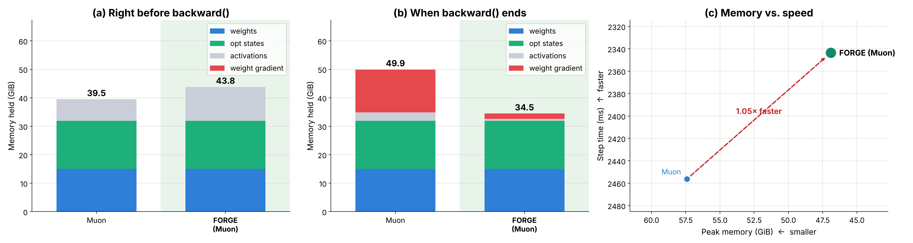
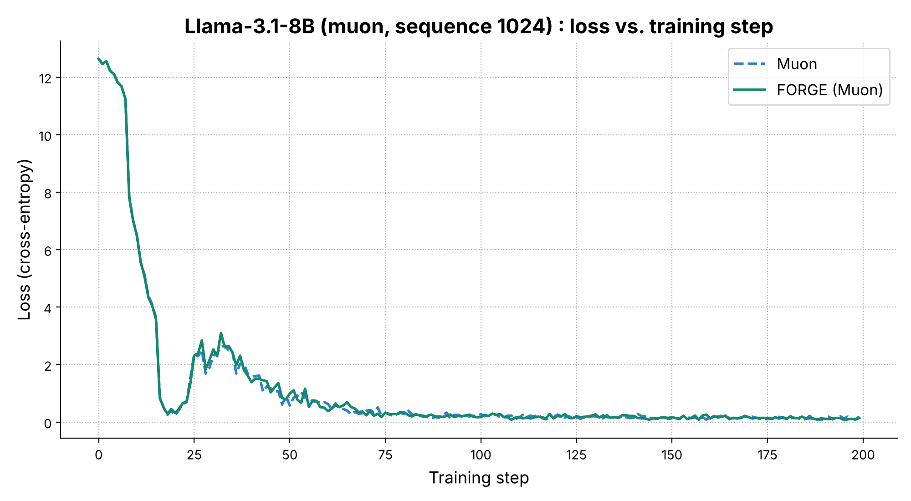
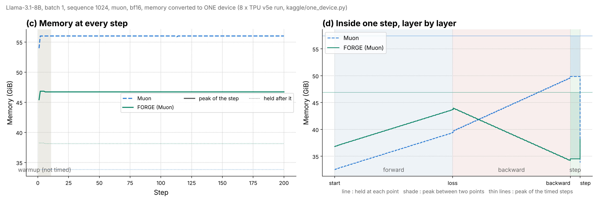
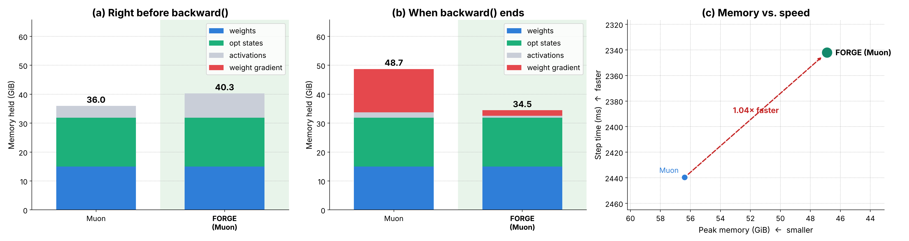
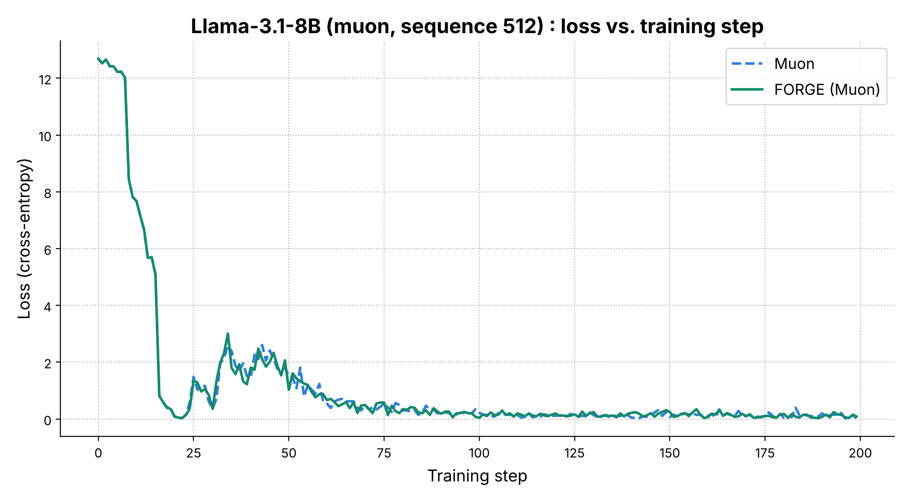
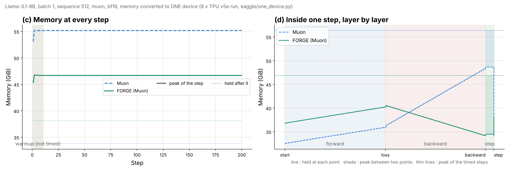

# Muon results (TPU v5e-8, tensor parallel over 8 chips)

Written by `benchmarks/readme.py` from the files in this folder. Do not edit by hand.

## Llama-3.1-8B, sequence 1024

Llama-3.1-8B, sequence 1024, 8.03B params, muon. Step time : median (± std) of 190 timed steps of each run, after 10 warmup steps. Peak : the largest step peak above the data, on the chip with the largest one. TF/s : the 8 chips together (peak 8 x 197).

| Method | Peak (GiB) | Step (ms) | TF/s |
|---|:--:|:--:|:--:|
| Muon | 10.20 | 2456.2 ± 20.1 | 21 ± 0 |
| FORGE (Muon) | 9.25 | 2343.5 ± 18.9 | 22 ± 0 |

| Method | Loss at step 200 (last common step) | max \|loss − Muon\| (steps 1 to 200) |
|---|:--:|:--:|
| Muon | 0.1844 | 0.0000 |
| FORGE (Muon) | 0.1401 | 0.4891 |

### Profile

NA : no profile in results/muon/llama8b_seq1024/

## Llama-3.1-8B, sequence 512

Llama-3.1-8B, sequence 512, 8.03B params, muon. Step time : median (± std) of 190 timed steps of each run, after 10 warmup steps. Peak : the largest step peak above the data, on the chip with the largest one. TF/s : the 8 chips together (peak 8 x 197).

| Method | Peak (GiB) | Step (ms) | TF/s |
|---|:--:|:--:|:--:|
| Muon | 9.75 | 2439.7 ± 21.2 | 10 ± 0 |
| FORGE (Muon) | 9.24 | 2342.0 ± 15.5 | 11 ± 0 |

| Method | Loss at step 200 (last common step) | max \|loss − Muon\| (steps 1 to 200) |
|---|:--:|:--:|
| Muon | 0.0292 | 0.0000 |
| FORGE (Muon) | 0.0894 | 0.6388 |

### Profile

NA : no profile in results/muon/llama8b_seq512/

# 8-chip checks (muon)

- chips (processes) : 8, devices seen by each process : ? (RuntimeError)
- all_reduce sum of rank+1 : 36.0 (want 36.0), bf16 : 36.0, all_gather of rank : [0.0, 1.0, 2.0, 3.0, 4.0, 5.0, 6.0, 7.0] -> PASS
- memory of each chip after 256 MiB on each (MiB) : [0, 0, 0, 0, 0, 0, 0, 0]

TP check : each small model in tensor parallel over the 8 chips against the same model on one chip (same weights and data), one step at lr 1e-2. Pass : gradient error (max |TP - 1 chip| / max |1 chip|, each tensor) <= 0.05, update error (|change TP - change 1 chip| / |change 1 chip|, each tensor) <= 0.5, the replicated (norm) weights equal on all chips.

| model | method | max gradient error | max update error | loss TP (4 steps) | loss 1 chip | replicated weights equal | result |
|---|---|---|---|---|---|---|---|
| Llama-3.1-8B (small) | muon | 1.73e-02 | 2.72e-01 | 7.6206 7.6911 7.7116 7.7372 | 7.6203 7.6911 7.7139 7.7414 | yes | PASS |
| Llama-3.1-8B (small) | forge_muon | 1.69e-02 | 2.72e-01 | 7.6206 7.6911 7.7123 7.7373 | 7.6203 7.6911 7.7141 7.7399 | yes | PASS |

**ALL PASS**

# FORGE correctness (muon) : 72 / 72 checks pass

| case | check | error | tolerance | result |
|---|---|--:|--:|:--:|
| module : from_linear, eval | shares weight (0 = yes) | 0 | 0 | PASS |
| module : from_linear, eval | eval out = F.linear | 0 | 0 | PASS |
| step muon bf16 state, float32 w, 128x256x128 | y | 0.00266 | 0.005 | PASS |
| step muon bf16 state, float32 w, 128x256x128 | dx | 0.00237 | 0.005 | PASS |
| step muon bf16 state, float32 w, 128x256x128 | w(rel) | 0.0861 | 0.1 | PASS |
| step muon bf16 state, float32 w, 128x256x128 | m | 1 | 1 | PASS |
| step muon bf16 state, float32 w, 64x512x256 | y | 0.00289 | 0.005 | PASS |
| step muon bf16 state, float32 w, 64x512x256 | dx | 0.00244 | 0.005 | PASS |
| step muon bf16 state, float32 w, 64x512x256 | w(rel) | 0.0715 | 0.1 | PASS |
| step muon bf16 state, float32 w, 64x512x256 | m | 1 | 1 | PASS |
| step muon bf16 state, float32 w, 256x1024x512 | y | 0.00234 | 0.005 | PASS |
| step muon bf16 state, float32 w, 256x1024x512 | dx | 0.00241 | 0.005 | PASS |
| step muon bf16 state, float32 w, 256x1024x512 | w(rel) | 0.0665 | 0.1 | PASS |
| step muon bf16 state, float32 w, 256x1024x512 | m | 1 | 1 | PASS |
| step muon bf16 state, float32 w, 1500x1536x2048 | y | 0.00253 | 0.005 | PASS |
| step muon bf16 state, float32 w, 1500x1536x2048 | dx | 0.00246 | 0.005 | PASS |
| step muon bf16 state, float32 w, 1500x1536x2048 | w(rel) | 0.0473 | 0.1 | PASS |
| step muon bf16 state, float32 w, 1500x1536x2048 | m | 1 | 1 | PASS |
| step muon bf16 state, bfloat16 w, 128x256x128 | y | 0.00313 | 0.005 | PASS |
| step muon bf16 state, bfloat16 w, 128x256x128 | dx | 0.00246 | 0.005 | PASS |
| step muon bf16 state, bfloat16 w, 128x256x128 | w(ulp+NS) | 0.939 | 1 | PASS |
| step muon bf16 state, bfloat16 w, 128x256x128 | m | 1 | 1 | PASS |
| step muon bf16 state, bfloat16 w, 64x512x256 | y | 0.00256 | 0.005 | PASS |
| step muon bf16 state, bfloat16 w, 64x512x256 | dx | 0.00273 | 0.005 | PASS |
| step muon bf16 state, bfloat16 w, 64x512x256 | w(ulp+NS) | 0.9 | 1 | PASS |
| step muon bf16 state, bfloat16 w, 64x512x256 | m | 1 | 1 | PASS |
| step muon bf16 state, bfloat16 w, 256x1024x512 | y | 0.00296 | 0.005 | PASS |
| step muon bf16 state, bfloat16 w, 256x1024x512 | dx | 0.00237 | 0.005 | PASS |
| step muon bf16 state, bfloat16 w, 256x1024x512 | w(ulp+NS) | 0.921 | 1 | PASS |
| step muon bf16 state, bfloat16 w, 256x1024x512 | m | 1 | 1 | PASS |
| step muon bf16 state, bfloat16 w, 1500x1536x2048 | y | 0.00302 | 0.005 | PASS |
| step muon bf16 state, bfloat16 w, 1500x1536x2048 | dx | 0.00309 | 0.005 | PASS |
| step muon bf16 state, bfloat16 w, 1500x1536x2048 | w(ulp+NS) | 0.922 | 1 | PASS |
| step muon bf16 state, bfloat16 w, 1500x1536x2048 | m | 1 | 1 | PASS |
| step muon bf16 state, bfloat16 w, 256x1024x512, g x1e-06 | y | 0.00296 | 0.005 | PASS |
| step muon bf16 state, bfloat16 w, 256x1024x512, g x1e-06 | dx | 0.00226 | 0.005 | PASS |
| step muon bf16 state, bfloat16 w, 256x1024x512, g x1e-06 | w(ulp+NS) | 0.921 | 1 | PASS |
| step muon bf16 state, bfloat16 w, 256x1024x512, g x1e-06 | m | 1 | 1 | PASS |
| step muon bf16 state, bfloat16 w, 64x512x256, bias | y | 0.00348 | 0.005 | PASS |
| step muon bf16 state, bfloat16 w, 64x512x256, bias | dx | 0.00273 | 0.005 | PASS |
| step muon bf16 state, bfloat16 w, 64x512x256, bias | db | 0.00239 | 0.005 | PASS |
| step muon bf16 state, bfloat16 w, 64x512x256, bias | w(ulp+NS) | 0.949 | 1 | PASS |
| step muon bf16 state, bfloat16 w, 64x512x256, bias | m | 1 | 1 | PASS |
| chain muon bf16 state, 2 layers, 10 steps (worst) | dh | 0.00334 | 0.005 | PASS |
| chain muon bf16 state, 2 layers, 10 steps (worst) | dx | 0.00319 | 0.005 | PASS |
| chain muon bf16 state, 2 layers, 10 steps (worst) | l2 w(ulp+NS) | 0.949 | 1 | PASS |
| chain muon bf16 state, 2 layers, 10 steps (worst) | l2 m | 1 | 1 | PASS |
| chain muon bf16 state, 2 layers, 10 steps (worst) | l1 w(ulp+NS) | 0.949 | 1 | PASS |
| chain muon bf16 state, 2 layers, 10 steps (worst) | l1 m | 1 | 1 | PASS |
| model forge_muon vs PyTorch bf16 muon | step 1 dw model.embed_tokens.weight | 2.22 | 4.44 | PASS |
| model forge_muon vs PyTorch bf16 muon | step 1 dw model.input_layernorm.weight | 1 | 2 | PASS |
| model forge_muon vs PyTorch bf16 muon | step 1 dw model.mlp.down_proj.weight | 0.295 | 0.589 | PASS |
| model forge_muon vs PyTorch bf16 muon | step 1 dw model.mlp.gate_proj.weight | 0.314 | 0.629 | PASS |
| model forge_muon vs PyTorch bf16 muon | step 1 dw model.mlp.up_proj.weight | 0.279 | 0.558 | PASS |
| model forge_muon vs PyTorch bf16 muon | step 1 dw model.norm.weight | 1 | 2 | PASS |
| model forge_muon vs PyTorch bf16 muon | step 1 dw model.post_attention_layernorm.weight | 1 | 2 | PASS |
| model forge_muon vs PyTorch bf16 muon | step 1 dw model.self_attn.k_proj.weight | 0.12 | 0.24 | PASS |
| model forge_muon vs PyTorch bf16 muon | step 1 dw model.self_attn.o_proj.weight | 0.916 | 1.83 | PASS |
| model forge_muon vs PyTorch bf16 muon | step 1 dw model.self_attn.q_proj.weight | 0.275 | 0.55 | PASS |
| model forge_muon vs PyTorch bf16 muon | step 1 dw model.self_attn.v_proj.weight | 0.578 | 1.16 | PASS |
| model forge_muon vs PyTorch bf16 muon | 30 steps dw model.embed_tokens.weight | 0.98 | 1.96 | PASS |
| model forge_muon vs PyTorch bf16 muon | 30 steps dw model.input_layernorm.weight | 1 | 2 | PASS |
| model forge_muon vs PyTorch bf16 muon | 30 steps dw model.mlp.down_proj.weight | 0.0812 | 0.181 | PASS |
| model forge_muon vs PyTorch bf16 muon | 30 steps dw model.mlp.gate_proj.weight | 0.0922 | 0.191 | PASS |
| model forge_muon vs PyTorch bf16 muon | 30 steps dw model.mlp.up_proj.weight | 0.0852 | 0.176 | PASS |
| model forge_muon vs PyTorch bf16 muon | 30 steps dw model.norm.weight | 1 | 2 | PASS |
| model forge_muon vs PyTorch bf16 muon | 30 steps dw model.post_attention_layernorm.weight | 1 | 2 | PASS |
| model forge_muon vs PyTorch bf16 muon | 30 steps dw model.self_attn.k_proj.weight | 0.085 | 0.179 | PASS |
| model forge_muon vs PyTorch bf16 muon | 30 steps dw model.self_attn.o_proj.weight | 0.336 | 0.838 | PASS |
| model forge_muon vs PyTorch bf16 muon | 30 steps dw model.self_attn.q_proj.weight | 0.118 | 0.224 | PASS |
| model forge_muon vs PyTorch bf16 muon | 30 steps dw model.self_attn.v_proj.weight | 0.184 | 0.433 | PASS |
| model forge_muon vs PyTorch bf16 muon | max |loss - ref| | 0.0491 | 0.13 | PASS |
