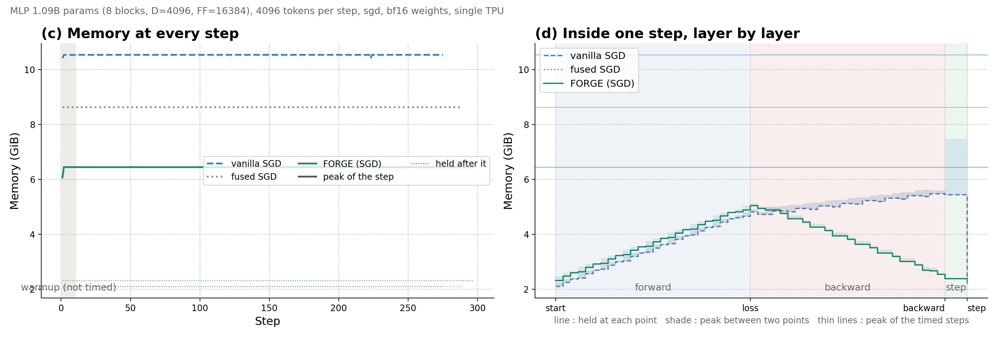
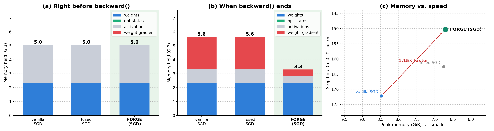
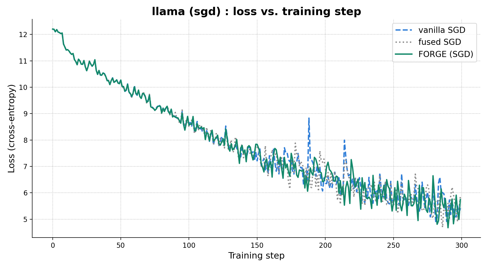
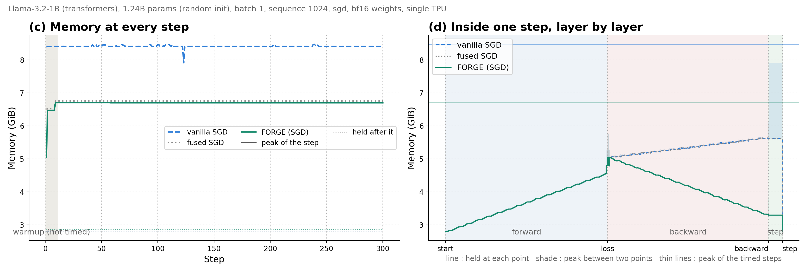

# FORGE TPU : SGD results (TPU v5e-1)

plain SGD, no momentum (`torch.optim.SGD` math with momentum = 0, FORGE : `SGD` in `src/forge_tpu/kernel/optimizers.py`). lr 1e-2, weight decay 0.01 on every model. bf16 weights.
SGD has no optimizer state, so FORGE (SGD) keeps only the weights. in Llama and Qwen the tied embedding / lm_head and the norms stay on torch's fused SGD.

| Name | .... |
|---|---|
| vanilla SGD | `torch.optim.SGD()` (torch's defaults), bf16 weights |
| fused SGD | `torch.optim.SGD(fused=True)`, bf16 weights |
| FORGE (SGD) | FORGE, bf16 weights, no state |

step time is the median of the timed steps (± std), the first 10 steps are not timed. each run stops after 60 s, that is why the number of steps is different. tiles (512, 2048, 2048).

## MLP

| Method | Peak (GiB) | Step (ms) | TF/s |
|---|:--:|:--:|:--:|
| vanilla SGD | 10.53 | 213.2 ± 0.1 | 126 |
| fused SGD | 8.63 | 203.3 ± 0.1 | 132 |
| FORGE (SGD) | 6.45 | 177.8 ± 0.1 | 151 |

## Llama-3.2-1B

| Method | Peak (GiB) | Step (ms) | TF/s |
|---|:--:|:--:|:--:|
| vanilla SGD | 8.47 | 172.2 ± 16.9 | 46 |
| fused SGD | 6.75 | 162.6 ± 15.4 | 49 |
| FORGE (SGD) | 6.71 | 150.3 ± 13.5 | 53 |

## Qwen3-0.6B

| Method | Peak (GiB) | Step (ms) | TF/s |
|---|:--:|:--:|:--:|
| vanilla SGD | 5.87 | 361.0 ± 18.9 | 12 |
| fused SGD | 5.87 | 349.4 ± 32.0 | 13 |
| FORGE (SGD) | 5.86 | 354.9 ± 24.0 | 12 |

TF/s = model FLOPs of one step (6 x params x tokens, + attention) / step time. the v5e peak is 197 TF/s in bf16.
