# SGD results (TPU v5e-1)

## MLP

MLP 1.09B params (8 blocks, D=4096, FF=16384), 4096 tokens per step, sgd, bf16 weights, single TPU. Step time is the median of 265 steps (± std), after 10 warmup steps.

| Method | Peak (GiB) | Step (ms) | TF/s |
|---|:--:|:--:|:--:|
| vanilla SGD | 10.53 | 213.2 ± 0.1 | 126 ± 0 |
| fused SGD | 8.63 | 203.3 ± 0.1 | 132 ± 0 |
| FORGE (SGD) | 6.45 | 177.8 ± 0.1 | 151 ± 0 |

| Method | Loss at step 275 (last common step) | max \|loss − vanilla SGD\| (steps 1 to 275) |
|---|:--:|:--:|
| vanilla SGD | 0.7278 | 0.0000 |
| fused SGD | 0.7278 | 0.0000 |
| FORGE (SGD) | 0.7278 | 0.0000 |

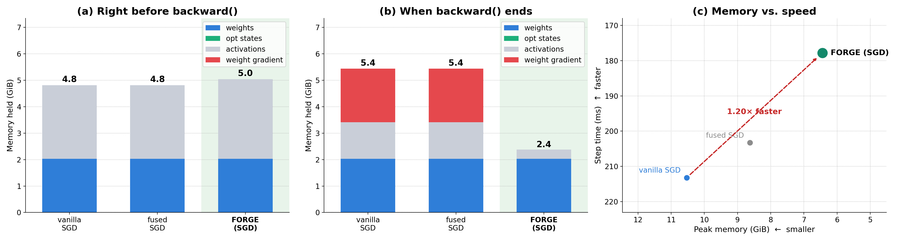
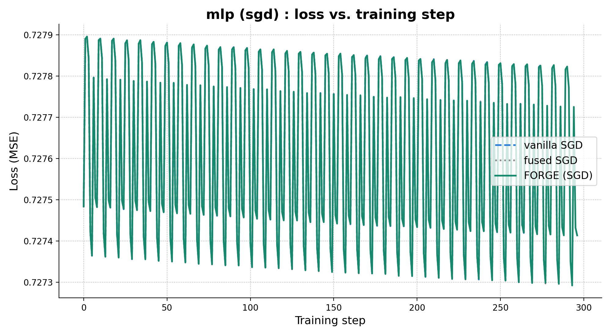

### Profile

#### MLP (sgd) : where the time of one step goes (ms, median of 20 steps)

| | vanilla SGD | fused SGD | FORGE (SGD) |
|---|:--:|:--:|:--:|
| **Sync after each phase** | | | |
| Forward | 68.7 | 68.6 | 68.7 |
| Backward : Python returns | 1.4 | 1.5 | 4.7 |
| Backward : TPU finishes | 123.6 | 123.6 | 108.2 |
| Optimizer step | 21.1 | 11.0 | 0.1 |
| Total | 213.3 | 203.3 | 177.0 |
| **As the benchmark (one sync at the end)** | | | |
| Python done issuing | 2.8 | 2.6 | 4.4 |
| Step time (TPU done) | **211.6** | **201.7** | **176.3** |
| of which FORGE Python | - | - | 1.1 |
| FORGE updates per step | - | - | 17 |

#### MLP (sgd) : profile in detail (median of 20 steps, after 10 warmup steps)

| Method | Step as benchmark (ms) | Python done issuing (ms) | Forward : Python / TPU done | Backward : Python / TPU done | Step : Python / TPU done | FORGE Python (ms) |
|---|:--:|:--:|:--:|:--:|:--:|:--:|
| vanilla SGD | 211.6 | 2.8 | 1.1 / 68.7 | 1.4 / 123.6 | 0.5 / 21.1 | 0.0 |
| fused SGD | 201.7 | 2.6 | 1.0 / 68.6 | 1.5 / 123.6 | 0.3 / 11.0 | 0.0 |
| FORGE (SGD) | 176.3 | 4.4 | 1.6 / 68.7 | 4.7 / 108.2 | 0.0 / 0.1 | 1.1 |

Host time per phase (ms, under the profiler), the 3 largest groups :

| Method | Forward | Backward | Step |
|---|---|---|---|
| vanilla SGD | elementwise 0.5, Python, waiting (no op) 0.4, matmul 0.2 | Python, waiting (no op) 0.5, copies, new tensors 0.4, autograd engine 0.4 | optimizer 0.2, Python, waiting (no op) 0.0, copies, new tensors 0.0 |
| fused SGD | elementwise 0.6, Python, waiting (no op) 0.4, matmul 0.3 | Python, waiting (no op) 0.6, copies, new tensors 0.5, autograd engine 0.4 | optimizer 0.2, Python, waiting (no op) 0.1, copies, new tensors 0.0 |
| FORGE (SGD) | elementwise 0.5, Python, waiting (no op) 0.4, matmul 0.2 | FORGE update (Python) 1.4, copies, new tensors 0.7, Python, waiting (no op) 0.7 | Python, waiting (no op) 0.0 |

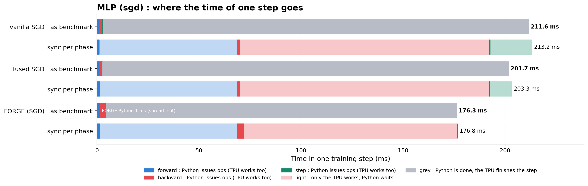
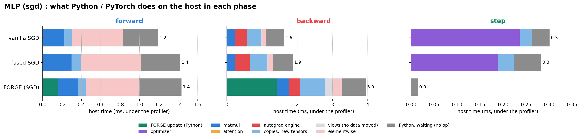

## Llama-3.2-1B

Llama-3.2-1B (transformers), 1.24B params (random init), batch 1, sequence 1024, sgd, bf16 weights, single TPU. Step time is the median of 290 steps (± std), after 10 warmup steps.

| Method | Peak (GiB) | Step (ms) | TF/s |
|---|:--:|:--:|:--:|
| vanilla SGD | 8.49 | 169.1 ± 16.1 | 47 ± 5 |
| fused SGD | 6.75 | 157.9 ± 13.4 | 51 ± 5 |
| FORGE (SGD) | 6.71 | 153.3 ± 7.5 | 52 ± 2 |

| Method | Loss at step 300 (last common step) | max \|loss − vanilla SGD\| (steps 1 to 300) |
|---|:--:|:--:|
| vanilla SGD | 5.4212 | 0.0000 |
| fused SGD | 5.8439 | 1.8330 |
| FORGE (SGD) | 5.7465 | 2.4620 |

### Profile

#### Llama-3.2-1B (sgd) : where the time of one step goes (ms, median of 20 steps)

| | vanilla SGD | fused SGD | FORGE (SGD) |
|---|:--:|:--:|:--:|
| **Sync after each phase** | | | |
| Forward | 58.2 | 57.4 | 45.7 |
| Backward : Python returns | 37.7 | 49.6 | 64.4 |
| Backward : TPU finishes | 92.5 | 90.1 | 72.0 |
| Optimizer step | 26.3 | 14.5 | 4.1 |
| Total | 177.0 | 162.0 | 121.8 |
| **As the benchmark (one sync at the end)** | | | |
| Python done issuing | 81.5 | 89.4 | 105.3 |
| Step time (TPU done) | **172.4** | **139.2** | **126.3** |
| of which FORGE Python | - | - | 14.6 |
| FORGE updates per step | - | - | 112 |

#### Llama-3.2-1B (sgd) : profile in detail (median of 20 steps, after 10 warmup steps)

| Method | Step as benchmark (ms) | Python done issuing (ms) | Forward : Python / TPU done | Backward : Python / TPU done | Step : Python / TPU done | FORGE Python (ms) |
|---|:--:|:--:|:--:|:--:|:--:|:--:|
| vanilla SGD | 172.4 | 81.5 | 42.6 / 58.2 | 37.7 / 92.5 | 2.5 / 26.3 | 0.0 |
| fused SGD | 139.2 | 89.4 | 45.8 / 57.4 | 49.6 / 90.1 | 1.1 / 14.5 | 0.0 |
| FORGE (SGD) | 126.3 | 105.3 | 35.2 / 45.7 | 64.4 / 72.0 | 0.9 / 4.1 | 14.6 |

Host time per phase (ms, under the profiler), the 3 largest groups :

| Method | Forward | Backward | Step |
|---|---|---|---|
| vanilla SGD | elementwise 15.8, copies, new tensors 7.9, Python, waiting (no op) 6.8 | elementwise 18.6, copies, new tensors 7.2, autograd engine 6.9 | optimizer 2.2, copies, new tensors 0.2, Python, waiting (no op) 0.0 |
| fused SGD | elementwise 18.0, copies, new tensors 8.9, Python, waiting (no op) 7.8 | elementwise 26.3, copies, new tensors 9.9, autograd engine 8.2 | optimizer 1.1, copies, new tensors 0.2, Python, waiting (no op) 0.1 |
| FORGE (SGD) | elementwise 16.0, Python, waiting (no op) 7.8, copies, new tensors 7.7 | elementwise 19.9, FORGE update (Python) 12.0, copies, new tensors 8.3 | optimizer 0.8, Python, waiting (no op) 0.1, copies, new tensors 0.1 |

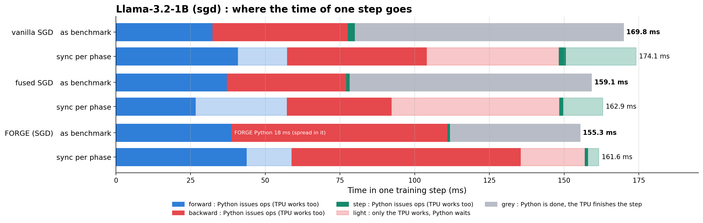
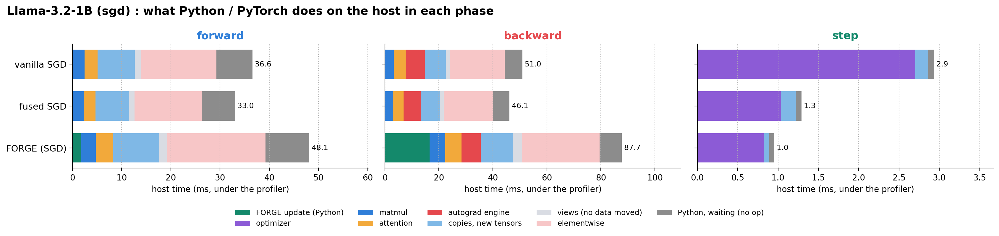

## Qwen3-0.6B

Qwen3-0.6B (transformers), 0.60B params (random init), batch 1, sequence 1024, sgd, bf16 weights, single TPU. Step time is the median of 990 steps (± std), after 10 warmup steps.

| Method | Peak (GiB) | Step (ms) | TF/s |
|---|:--:|:--:|:--:|
| vanilla SGD | 5.87 | 355.2 ± 44.2 | 12 ± 2 |
| fused SGD | 5.87 | 351.6 ± 38.4 | 12 ± 2 |
| FORGE (SGD) | 5.86 | 350.0 ± 36.9 | 13 ± 1 |

| Method | Loss at step 1000 (last common step) | max \|loss − vanilla SGD\| (steps 1 to 1000) |
|---|:--:|:--:|
| vanilla SGD | 6.5139 | 0.0000 |
| fused SGD | 6.5139 | 0.0020 |
| FORGE (SGD) | 6.5136 | 0.0017 |

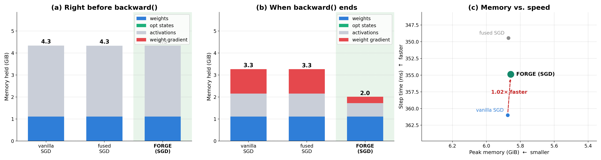
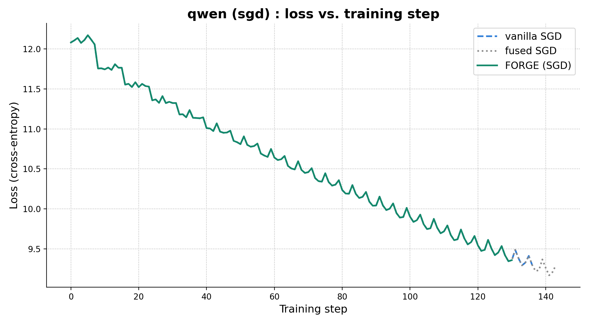
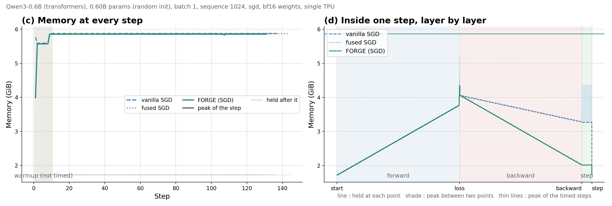

### Profile

#### Qwen3-0.6B (sgd) : where the time of one step goes (ms, median of 20 steps)

| | vanilla SGD | fused SGD | FORGE (SGD) |
|---|:--:|:--:|:--:|
| **Sync after each phase** | | | |
| Forward | 112.0 | 123.2 | 123.0 |
| Backward : Python returns | 112.1 | 111.5 | 157.5 |
| Backward : TPU finishes | 207.7 | 215.6 | 227.2 |
| Optimizer step | 18.4 | 11.1 | 6.1 |
| Total | 338.1 | 349.9 | 356.4 |
| **As the benchmark (one sync at the end)** | | | |
| Python done issuing | 175.7 | 192.0 | 243.9 |
| Step time (TPU done) | **359.6** | **399.0** | **354.5** |
| of which FORGE Python | - | - | 26.4 |
| FORGE updates per step | - | - | 196 |

#### Qwen3-0.6B (sgd) : profile in detail (median of 20 steps, after 10 warmup steps)

| Method | Step as benchmark (ms) | Python done issuing (ms) | Forward : Python / TPU done | Backward : Python / TPU done | Step : Python / TPU done | FORGE Python (ms) |
|---|:--:|:--:|:--:|:--:|:--:|:--:|
| vanilla SGD | 359.6 | 175.7 | 72.7 / 112.0 | 112.1 / 207.7 | 6.3 / 18.4 | 0.0 |
| fused SGD | 399.0 | 192.0 | 64.8 / 123.2 | 111.5 / 215.6 | 2.7 / 11.1 | 0.0 |
| FORGE (SGD) | 354.5 | 243.9 | 75.1 / 123.0 | 157.5 / 227.2 | 2.1 / 6.1 | 26.4 |

Host time per phase (ms, under the profiler), the 3 largest groups :

| Method | Forward | Backward | Step |
|---|---|---|---|
| vanilla SGD | elementwise 42.6, copies, new tensors 22.6, Python, waiting (no op) 21.5 | elementwise 67.7, copies, new tensors 25.3, autograd engine 18.0 | optimizer 8.4, copies, new tensors 0.4, Python, waiting (no op) 0.1 |
| fused SGD | elementwise 36.8, copies, new tensors 19.4, Python, waiting (no op) 17.4 | elementwise 84.5, copies, new tensors 30.3, autograd engine 20.3 | optimizer 3.3, copies, new tensors 0.5, Python, waiting (no op) 0.1 |
| FORGE (SGD) | elementwise 28.8, Python, waiting (no op) 15.8, copies, new tensors 15.7 | elementwise 78.6, copies, new tensors 30.6, FORGE update (Python) 27.1 | optimizer 2.6, copies, new tensors 0.2, Python, waiting (no op) 0.1 |

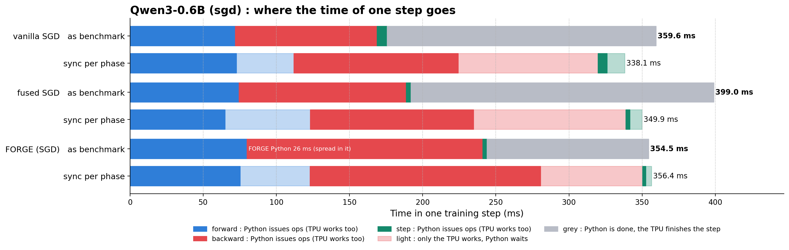
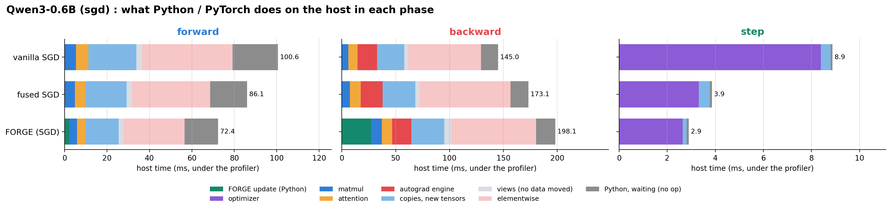
